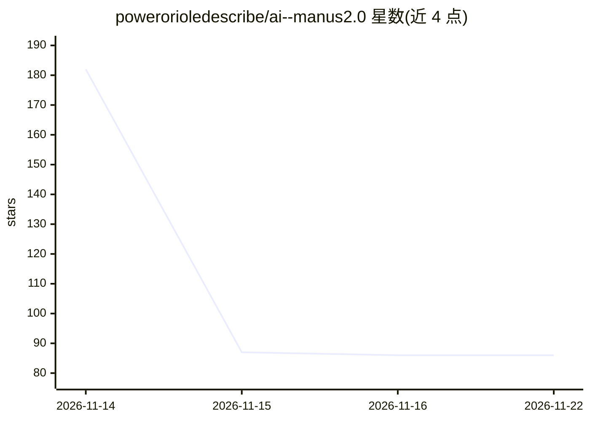

# powerorioledescribe/ai--manus2.0

⭐ 86 · Apache-2.0 · 推送 2026-11-15 · [GitHub](https://github.com/powerorioledescribe/ai--manus2.0) · 个人维护

**面向日常任务的自主 AI Agent：自行执行代码与控制浏览器**

定位为个人/轻量场景的自主 agent：用户描述需求后，它编写并执行脚本、打开网页并与其交互、执行多步骤任务，覆盖学习研究、家庭项目、轻办公与开发测试等场景。README 描述其在会话间保持一致的任务模式，脚本与浏览器动作可在同一流程中衔接。README 未给出具体的模型后端、安装命令或代码结构说明，仅含配置与使用步骤的文字描述和系统兼容性表。

## 筛选速览

| 维度 | 判定 | 备注 |
|---|---|---|
| AI 角色 | `ai-native` | 本体是模型或模型工具 |
| 许可风险 | `permissive` | Apache-2.0 |
| 部署形态 | `None` |  |
| 模型依赖 | — | README 未给出锁定关系 |
| 硬件要求 | — | 无带数字的原话,不猜 |
| 安装摩擦 | `low` | 无编译、无系统依赖或容器化 |
| 成熟度 | — | 结构信号不足 |

## 能力要点

- 自主执行代码与控制浏览器，衔接脚本与网页操作
- 支持多步骤任务，描述需求后由 agent 规划执行
- 面向家庭、学习与小规模工作场景而非企业平台

## 适用场景

- 让 agent 代为查网页、填表单、收集多页信息
- 用自然语言驱动小脚本编写与运行实验
- 整理研究笔记、文件与日常重复性事务

## 场景标签

`浏览器自动化` · 领域:效率与自动化

## 证据(README 行号)

> L18: Manus is an autonomous AI agent designed to run code and control a browser on your behalf. Instead of acting like a
> L22: Manus is not a heavy studio suite or a complex enterprise platform. It is a focused helper built for home, study, a

## 星数曲线

2026-11-14 182 → 2026-11-22 86（-96）

---
*卡片 v1 · prompt 1.4 · 生成 2026-11-17 · 置信度 mid · 依据 README sha `637da4fbcded` · [字段定义](../../DATASET.md)*
