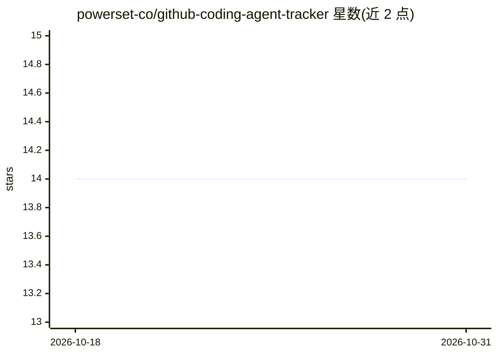

# powerset-co/github-coding-agent-tracker

⭐ 14 · TypeScript · MIT · 推送 2026-10-30 · [GitHub](https://github.com/powerset-co/github-coding-agent-tracker) · [官网](https://research.powerset.co/) · 组织维护

**追踪公开 GitHub 提交中 AI 编程 agent 占比的数据集**

由 GitHub Action 每日自动运行，通过 GitHub Search API 按各编程 agent 的签名（如 Co-Authored-By 邮箱、bot 账号）统计公开仓库默认分支上的提交数，与总公开提交量对比得出百分比，结果以 CSV 形式（data/YYYY-MM-DD.csv）提交回本仓库并更新图表。README 列出方法学限制：仅覆盖公开仓库、仅检测留下签名的提交、仅默认分支。提供 DuckDB 查询示例与本地运行/回填命令（bun）。

## 筛选速览

| 维度 | 判定 | 备注 |
|---|---|---|
| AI 角色 | `ai-knowledge` | 知识聚合/清单类 |
| 许可风险 | `permissive` | MIT |
| 部署形态 | `None` |  |
| 模型依赖 | — | README 未给出锁定关系 |
| 硬件要求 | — | 无带数字的原话,不猜 |
| 安装摩擦 | `low` | 无编译、无系统依赖或容器化 |
| 成熟度 | — | 结构信号不足 |

## 能力要点

- 每日 GitHub Action 自动采集 10 种编程 agent 的提交计数
- 数据以平铺 CSV 存储在仓库内，可用 DuckDB 直接查询
- 明确列出方法学限制（仅公开仓库、仅签名提交、仅默认分支）
- 支持按日期范围回填历史数据（受 API 限速约 1 天/分钟）

## 适用场景

- 查看 AI 编程 agent 在公开提交中的占比趋势
- 用 DuckDB 对历史 CSV 数据做自定义分析
- 了解各 agent 的签名检测方式以复现统计

## 场景标签

`数据分析` · 领域:效率与自动化

## 证据(README 行号)

> L3: A public, auditable log of AI coding agent commit counts on public GitHub repos over time.
> L35: Results are stored as flat CSVs in `data/YYYY-MM-DD.csv` and committed back to this repo, along with an updated cha

## 星数曲线

2026-10-18 14 → 2026-10-31 14（+0）

---
*卡片 v1 · prompt 1.4 · 生成 2026-10-31 · 置信度 high · 依据 README sha `3c1e94b4de35` · [字段定义](../../DATASET.md)*
