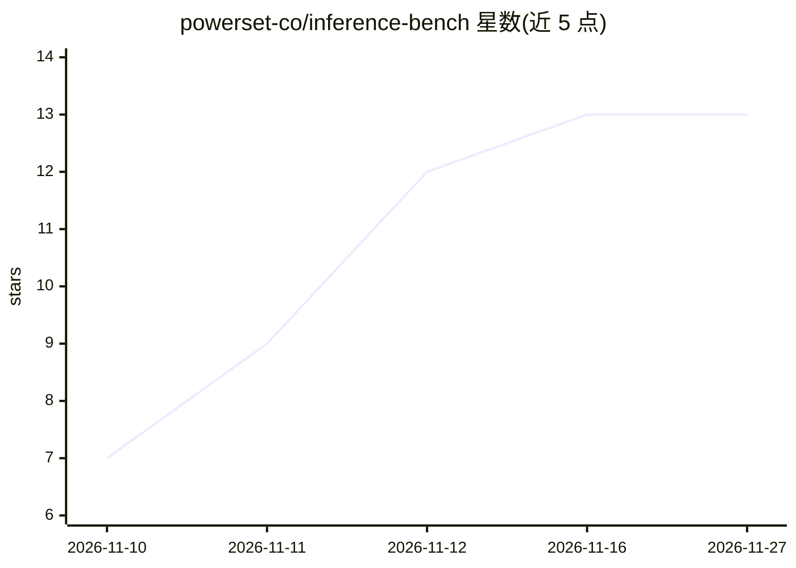

# powerset-co/inference-bench

⭐ 13 · TypeScript · MIT · 推送 2026-11-12 · [GitHub](https://github.com/powerset-co/inference-bench) · 组织维护

**对推理服务商的速度与成本做基准测试的工具**

录制开源 LLM 完成 FRAMES 多跳研究任务时的对话，然后在各推理服务商上回放同样的请求，测量每次模型调用的耗时与按标价计算的成本；排除缓存影响、失败重试、限流等待等因素，只比较服务商对同一模型的 serving 表现而非模型能力。工具以 Node.js 脚本形式提供，通过 npm 安装依赖、配置 .env 中的各家 key 后运行，输出图表与 results/summary.csv。README 声明项目处于 beta，方法与结果可能变化，且仅测单 agent 负载，不反映高并发场景。

## 筛选速览

| 维度 | 判定 | 备注 |
|---|---|---|
| AI 角色 | `ai-ecosystem` | LLM/agent 周边工具 |
| 许可风险 | `permissive` | MIT |
| 部署形态 | `library` | 以包/库形式分发 |
| 模型依赖 | — | README 未给出锁定关系 |
| 硬件要求 | — | 无带数字的原话,不猜 |
| 安装摩擦 | `low` | 无编译、无系统依赖或容器化 |
| 成熟度 | `idea` | |

## 能力要点

- 录制-回放机制：仅计时模型调用，排除工具与网络因素
- 覆盖 10 家推理服务商，统一 temperature 0 与 minimal reasoning 设置
- 缓存对照测试：重发去除缓存的最后一轮以衡量缓存收益
- npm 脚本运行，输出 30 天滚动平均图表与 CSV 汇总

## 适用场景

- 为研究型 agent 选型时比较各推理服务商的延迟与成本
- 复现或扩展基准方法，按需对特定服务商重跑测试
- 评估缓存对长对话 agent 任务耗时的影响

## 场景标签

`模型评测` · 领域:评测与运维

## 证据(README 行号)

> L10: How fast and how cheap is each inference provider at serving an **AI research agent** using open-source LLMs?
> L19: whether its answers are right. The purpose of this benchmark is to compare timing and cost across

## 星数曲线

2026-11-10 7 → 2026-11-27 13（+6）

---
*卡片 v1 · prompt 1.4 · 生成 2026-11-18 · 置信度 high · 依据 README sha `952971e7794a` · [字段定义](../../DATASET.md)*
