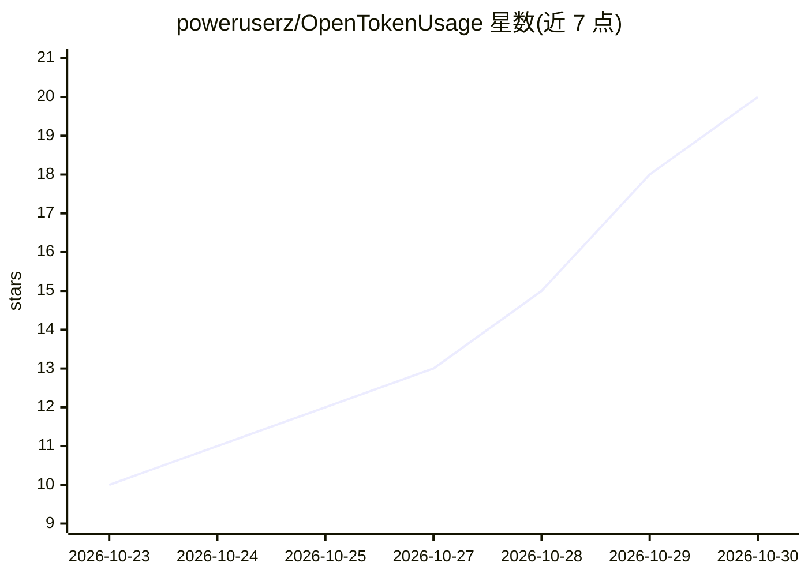

# poweruserz/OpenTokenUsage

⭐ 20 · TypeScript · MIT · 推送 2026-10-29 · [GitHub](https://github.com/poweruserz/OpenTokenUsage) · [官网](https://opentokenusage.app) · 个人维护 · 中文 README

**Windows 11 托盘应用：集中显示各 AI 编程订阅的用量限额**

驻留 Windows 11 通知区的桌面应用，读取用户已登录的 AI 编程服务账户，在托盘与任务栏条显示会话/周限额、额度、重置倒计时、使用节奏与告警通知。支持 Claude、Codex、Cursor、Copilot、Grok、Kimi Code 等 16+ 个服务商，采用插件架构，提供本地 HTTP API（127.0.0.1:6736）与 SOCKS5/HTTP 代理。通过 WinGet 或安装包安装，无需管理员权限；无遥测，可从源码用 Rust/Bun/Tauri 构建。

## 筛选速览

| 维度 | 判定 | 备注 |
|---|---|---|
| AI 角色 | `ai-ecosystem` | LLM/agent 周边工具 |
| 许可风险 | `permissive` | MIT |
| 部署形态 | `desktop` | 安装包/桌面程序 |
| 模型依赖 | locked-api |  |
| 硬件要求 | — | 无带数字的原话,不猜 |
| 安装摩擦 | `low` | 无编译、无系统依赖或容器化 |
| 成熟度 | `idea` | |

## 能力要点

- 托盘/任务栏条显示多服务商的会话与周限额、额度与重置倒计时
- 16+ 服务商插件架构（Claude、Codex、Cursor、Copilot、Grok 等）
- 用速节奏判定与自定义阈值通知
- 本地回环 HTTP API 供其他应用读取用量

## 适用场景

- 在任务栏一眼查看多个 AI 编程订阅的剩余额度
- 在限额重置前收到提醒通知
- 让本机其他工具通过本地 API 读取用量数据

## 场景标签

 · 领域:开发者工具/桌面应用

## 证据(README 行号)

> L11: OpenTokenUsage lives in the notification area and shows how much of your AI coding subscriptions you've used: sessi
> L42: - **Local HTTP API.** Other apps on your PC can read your usage from `127.0.0.1:6736` (loopback only).
> L65: ## Supported Providers

## 星数曲线

2026-10-23 10 → 2026-10-30 20（+10）

---
*卡片 v1 · prompt 1.4 · 生成 2026-10-29 · 置信度 mid · 依据 README sha `1bee2098aeb6` · [字段定义](../../DATASET.md)*
