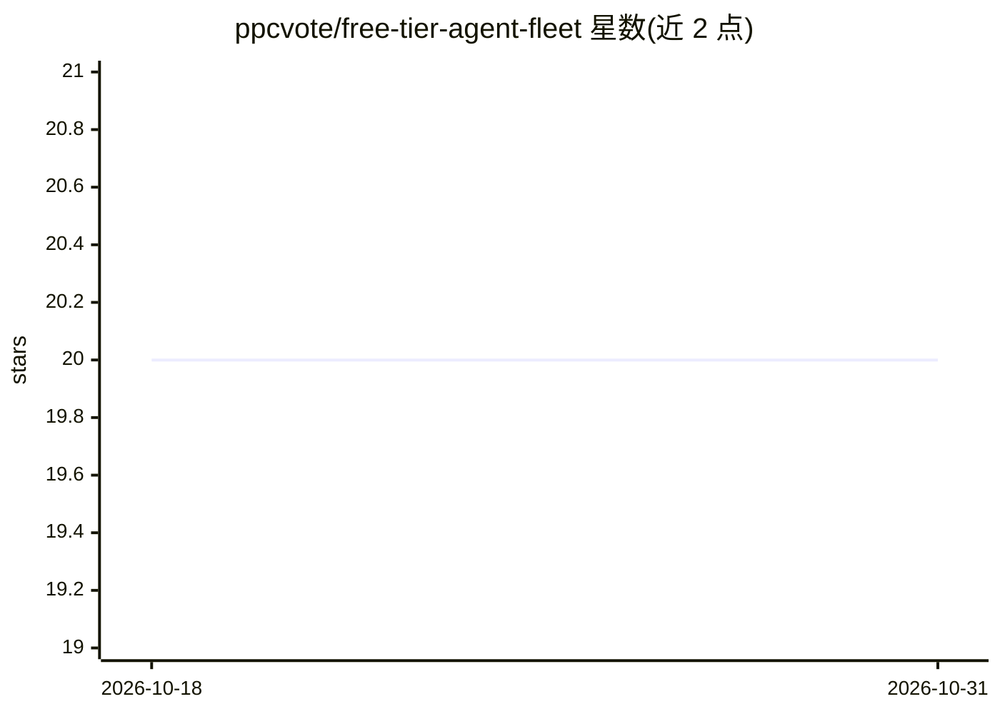

# ppcvote/free-tier-agent-fleet

⭐ 20 · Shell · MIT · 推送 2026-03-20 · [GitHub](https://github.com/ppcvote/free-tier-agent-fleet) · 个人维护 · 中文 README

**在 Gemini 免费额度上运行 4 个自主 agent 的脚本与方法手册**

面向独立开发者的开源 playbook：用 80+ 个脚本、25 个 systemd 定时器和 19 个情报文件，在 Gemini 2.5 Flash 免费层（1,500 RPD）上运行 CEO/社媒/安全/顾问 4 个 agent，每天约 105 个任务，LLM 费用 $0，基础设施约 $5/月。包含 6 层架构（质量门、数据驱动上下文、对话线程、同行评审、周策略、研究链）、3 层自愈系统、7 个进化模块（闭环学习、dream cycle、agent 竞技场等）。依赖 OpenClaw 框架与 Linux/WSL2 环境，脚本默认面向 Moltbook 平台但模式可适配任意有 API 的平台。

## 筛选速览

| 维度 | 判定 | 备注 |
|---|---|---|
| AI 角色 | `ai-ecosystem` | LLM/agent 周边工具 |
| 许可风险 | `permissive` | MIT |
| 部署形态 | `None` |  |
| 模型依赖 | local-ok | 支持本地模型 |
| 硬件要求 | — | 无带数字的原话,不猜 |
| 安装摩擦 | `low` | 无编译、无系统依赖或容器化 |
| 成熟度 | — | 结构信号不足 |

## 能力要点

- 4 个角色 agent（CEO/社媒/安全/顾问）在 Gemini 免费层运行，约 105 任务/天、$0/月 LLM 成本
- 80+ 脚本、25 个 systemd 定时器、19 个情报文件的完整编排
- 3 层自愈（检测→AI 诊断→人工告警）含 6 个自动修复脚本与预测性运维
- 7 个进化模块：闭环学习、dream cycle、agent 竞技场、Ollama 质量门等

## 适用场景

- 以接近零成本运行自主多 agent 内容与运营流水线
- 搭建带自愈与周度策略规划的开源 agent 编排系统
- 研究免费层 RPD 预算下的多 agent 任务分配方案

## 场景标签

`多智能体` · 领域:Agent 开发

## 证据(README 行号)

> L5: A complete playbook for running an autonomous multi-agent business on a single LLM's free tier. Every script, timer,
> L108: - OpenClaw installed

## 星数曲线

2026-10-18 20 → 2026-10-31 20（+0）

---
*卡片 v1 · prompt 1.4 · 生成 2026-10-28 · 置信度 high · 依据 README sha `efc114ae6495` · [字段定义](../../DATASET.md)*
