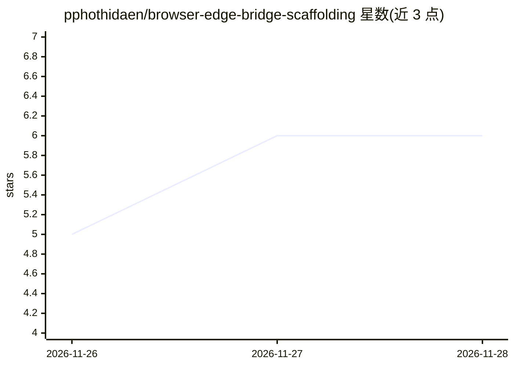

# pphothidaen/browser-edge-bridge-scaffolding

⭐ 6 · JavaScript · MIT · 推送 2026-11-24 · [GitHub](https://github.com/pphothidaen/browser-edge-bridge-scaffolding) · [官网](https://github.com/pphothidaen/browser-edge-bridge-scaffolding) · 个人维护

**把已登录浏览器会话桥接为 OpenAI 兼容 API 与 MCP 服务器的脚手架**

基于 Cloudflare Workers 与 Durable Objects 的领域中立脚手架，通过 Manifest V3 浏览器扩展把用户已认证的浏览器会话暴露为标准 AI 开发者接口：OpenAI 兼容 REST API（含 SSE 流式）与远程 MCP Server（JSON-RPC 2.0）。请求经边缘网关进入单例 Durable Object（ExtHub），经序列化 FIFO 队列、背压控制与逐任务超时分发到扩展，在用户活动标签页内执行；凭据仅留在浏览器运行时，不上传边缘节点。部署需 wrangler 与 Worker secrets 配置。

## 筛选速览

| 维度 | 判定 | 备注 |
|---|---|---|
| AI 角色 | `ai-ecosystem` | LLM/agent 周边工具 |
| 许可风险 | `permissive` | MIT |
| 部署形态 | `library` | 以包/库形式分发 |
| 模型依赖 | — | README 未给出锁定关系 |
| 硬件要求 | — | 无带数字的原话,不猜 |
| 安装摩擦 | `low` | 无编译、无系统依赖或容器化 |
| 成熟度 | — | 结构信号不足 |

## 能力要点

- OpenAI 兼容 REST 端点（/v1/chat/completions、/v1/models）支持 SSE 流式
- 远程 MCP Server（POST /mcp）提供 bridge_chat、web_search、summarize 等工具
- 零上游凭据泄漏设计：cookies 与 token 仅存于浏览器运行时
- Durable Objects 上的 FIFO 任务队列、背压与 fail-closed 错误保护

## 适用场景

- 让 AI Agent 或 IDE 扩展通过 OpenAI SDK 调用我在浏览器里已登录的会话
- 把浏览器内可用的模型与搜索能力作为 MCP 工具接入 MCP 客户端
- 在 Cloudflare 边缘上搭建自己的浏览器桥接网关并二次开发 provider adapter

## 场景标签

`模型网关` · 领域:Agent 开发

## 证据(README 行号)

> L10: **A generic, domain-neutral scaffolding for bridging authenticated browser sessions into OpenAI-compatible REST API
> L21: 2. **Remote MCP Server** over JSON-RPC 2.0 (`POST /mcp`) supporting standard tool discovery and execution.
> L34: **English:** Requests flow from AI clients through the Cloudflare Worker Edge Gateway into the singleton Durable Ob

## 星数曲线

2026-11-26 5 → 2026-11-28 6（+1）

---
*卡片 v1 · prompt 1.4 · 生成 2026-11-26 · 置信度 high · 依据 README sha `b3eec9edae08` · [字段定义](../../DATASET.md)*
