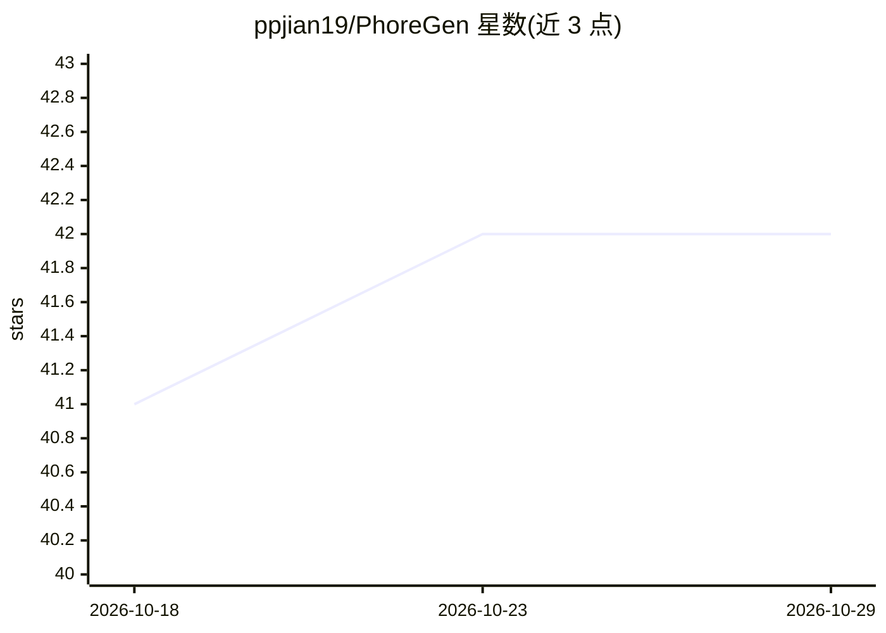

# ppjian19/PhoreGen

⭐ 42 · Python · MIT · 推送 2026-01-26 · [GitHub](https://github.com/ppjian19/PhoreGen) · [官网](https://phoregen.ddtmlab.org/) · 组织维护

**面向药效团约束的 3D 分子生成框架，用于药物发现**

PhoreGen 是基于扩散去噪的药效团导向 3D 分子生成框架：给定药效团模型，生成与其精确对齐的完整 3D 分子。机制上采用异步扰动、原子与键信息同步更新，并在消息传递中引入配体-药效团映射先验；通过对配体-药效团对（来自 3D 配体、复合物结构及对接构象）的分层学习进行预训练与微调，输出 .sdf 格式 3D 分子结构。面向药物设计研究者，需 Python 3.9 + PyTorch + CUDA 环境经 conda 安装运行，药效团模型需通过 AncPhore 在线工具另行生成。

## 筛选速览

| 维度 | 判定 | 备注 |
|---|---|---|
| AI 角色 | `ai-native` | 本体是模型或模型工具 |
| 许可风险 | `permissive` | MIT |
| 部署形态 | `None` |  |
| 模型依赖 | — | README 未给出锁定关系 |
| 硬件要求 | — | 无带数字的原话,不猜 |
| 安装摩擦 | `medium` | 含编译或系统依赖之一 |
| 成熟度 | — | 结构信号不足 |

## 能力要点

- 给定药效团模型生成对齐的完整 3D 分子
- 扩散去噪过程中异步扰动与原子/键同步更新
- 消息传递机制引入配体-药效团映射先验
- 支持预训练（LigPhore）与微调（CpxPhore/DockPhore）

## 适用场景

- 按药效团约束批量生成 3D 候选分子
- 生成含共价基团、金属结合 motif 的特征定制分子
- 基于自备数据集训练或微调模型

## 场景标签

`科研工具` · 领域:学习与行业

## 证据(README 行号)

> L8: PhoreGen is a pharmacophore-oriented 3D molecular generation framework designed to generate entire 3D molecules that
> L43: python sample_all.py --num_samples 100 --outdir ./results/test --phore_file_list ./data/phore_for_sampling/file_ind

## 星数曲线

2026-10-18 41 → 2026-10-29 42（+1）

---
*卡片 v1 · prompt 1.4 · 生成 2026-10-25 · 置信度 high · 依据 README sha `90fe5a73674a` · [字段定义](../../DATASET.md)*
