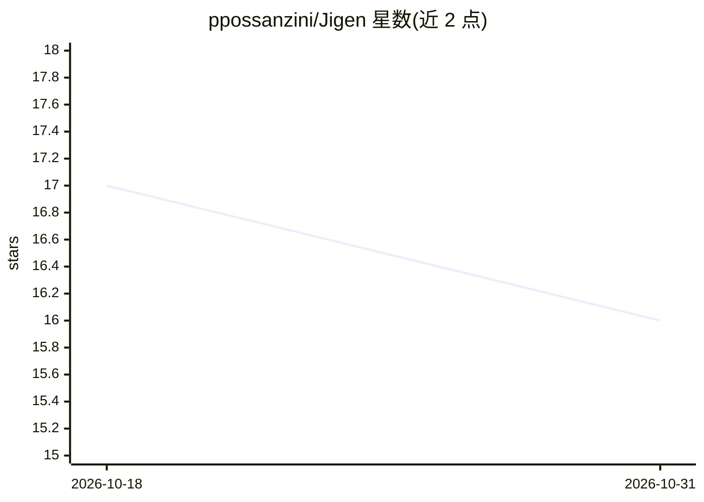

# ppossanzini/Jigen

⭐ 16 · C# · Apache-2.0 · 推送 2026-10-26 · [GitHub](https://github.com/ppossanzini/Jigen) · 个人维护

**C#/.NET 从零实现的向量数据库，可嵌入也可独立服务器运行**

用 C# 为 .NET 平台从零编写的向量数据库，可像 SQLite 一样进程内嵌入应用，也可作为带 gRPC/REST API 的独立服务器运行。核心包含 append-only 内存映射存储、磁盘持久化的 HNSW 近似最近邻索引、稀疏倒排索引与稠密+稀疏混合检索；内嵌基于 ONNX Runtime 的文本 embedding 生成（CPU 默认，可选 GPU provider），可经 RabbitMQ 扩展为独立 worker。提供类型化 .NET 客户端、Python 客户端与 Docker 镜像，另带 Web 管理 UI。项目起源为研究性质，代码经 AI 辅助优化。

## 筛选速览

| 维度 | 判定 | 备注 |
|---|---|---|
| AI 角色 | `ai-ecosystem` | LLM/agent 周边工具 |
| 许可风险 | `permissive` | Apache-2.0 |
| 部署形态 | `self-host` | docker 或自建部署 |
| 模型依赖 | — | README 未给出锁定关系 |
| 硬件要求 | — | 无带数字的原话,不猜 |
| 安装摩擦 | `low` | 无编译、无系统依赖或容器化 |
| 成熟度 | — | 结构信号不足 |

## 能力要点

- 进程内引擎与独立服务器两种运行形态（gRPC/REST）
- HNSW 磁盘持久化索引，支持 SQ8 量化与精确重排
- 稠密+稀疏混合检索，按倒数排名融合
- 服务端 ONNX embedding 生成，CPU/GPU 可选

## 适用场景

- 在 .NET 应用内嵌入向量检索能力，无需独立数据库服务
- 为 RAG 应用提供向量存储与混合检索服务
- 在服务端统一生成文本 embedding 并可水平扩展

## 场景标签

`向量数据库` · 领域:知识与检索

## 证据(README 行号)

> L5: **Jigen DB** is a vector database written from scratch in C# for the .NET platform.
> L7: Use it **in-process** inside your application — like SQLite, but for vector search — or run it as a **standalone ser
> L30: - **Server**: multi-database host with gRPC (port 3223) and REST (port 13223) APIs, per-collection dense, sparse an

## 星数曲线

2026-10-18 17 → 2026-10-31 16（-1）

---
*卡片 v1 · prompt 1.4 · 生成 2026-10-29 · 置信度 high · 依据 README sha `1b68d18d6567` · [字段定义](../../DATASET.md)*
