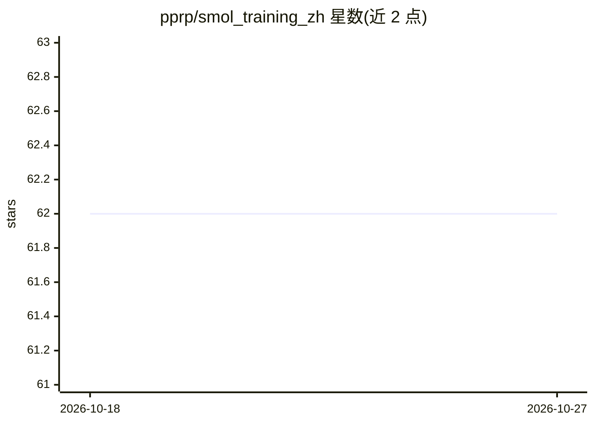

# pprp/smol_training_zh

⭐ 62 · TeX · 推送 2026-05-15 · [GitHub](https://github.com/pprp/smol_training_zh) · [官网](https://huggingface.co/spaces/HuggingFaceTB/smol-training-playbook) · 个人维护 · 中文 README

**SmolLM3 训练博客中文翻译：LLM 预训练/后训练/基础设施指南**

Hugging Face《Smol 训练手册》的中文翻译仓库，讲述 SmolLM3（3B 参数、11T token 训练）的完整训练过程。内容分为四部分：训练指南针（是否应自训模型的战略讨论）、预训练（消融实验、架构选型、数据混合、超参）、后训练（SFT/DPO/GRPO、模型合并）、基础设施（GPU 集群通信与瓶颈排查）。文中比较 Megatron-LM/DeepSpeed/TorchTitan/Nanotron 四种训练框架，并给出 2025 年基线模型家族清单。属知识文档，非可安装代码。

## 筛选速览

| 维度 | 判定 | 备注 |
|---|---|---|
| AI 角色 | `ai-knowledge` | 知识聚合/清单类 |
| 许可风险 | `none` | — |
| 部署形态 | `library` | 以包/库形式分发 |
| 模型依赖 | — | README 未给出锁定关系 |
| 硬件要求 | — | 无带数字的原话,不猜 |
| 安装摩擦 | `low` | 无编译、无系统依赖或容器化 |
| 成熟度 | — | 结构信号不足 |

## 能力要点

- 以 SmolLM3 实际训练过程为例覆盖预训练到后训练全流程
- 对比 Megatron-LM/DeepSpeed/TorchTitan/Nanotron 四种训练框架
- 给出 Dense/MoE/Hybrid 架构的基线模型选项清单
- 含训练决策框架：是否自训模型的战略讨论

## 适用场景

- 我准备从零预训练 LLM，想学习完整的决策与实验流程
- 我在选训练框架，需要对比主流方案的权衡
- 我想了解 SmolLM3 背后的训练经验与踩坑记录

## 场景标签

`教程课程` · 领域:学习与行业

## 证据(README 行号)

> L1: # Smol 训练手册：打造世界级 LLM 的秘诀 (中文版)
> L12: 请与我们一起走进 SmolLM3 的训练幕后——这是一个 30 亿参数的多语言推理模型，在 11 万亿 token 上完成训练。这不是一篇普通的博客，而是一张由决策、发现与死胡同交织成的蛛网，我们将其逐条拆解，最终沉淀出打造世界级
> L20: ### 如何阅读这篇博客文章

## 星数曲线

2026-10-18 62 → 2026-10-27 62（+0）

---
*卡片 v1 · prompt 1.4 · 生成 2026-10-24 · 置信度 mid · 依据 README sha `0c4edc1c094e` · [字段定义](../../DATASET.md)*
