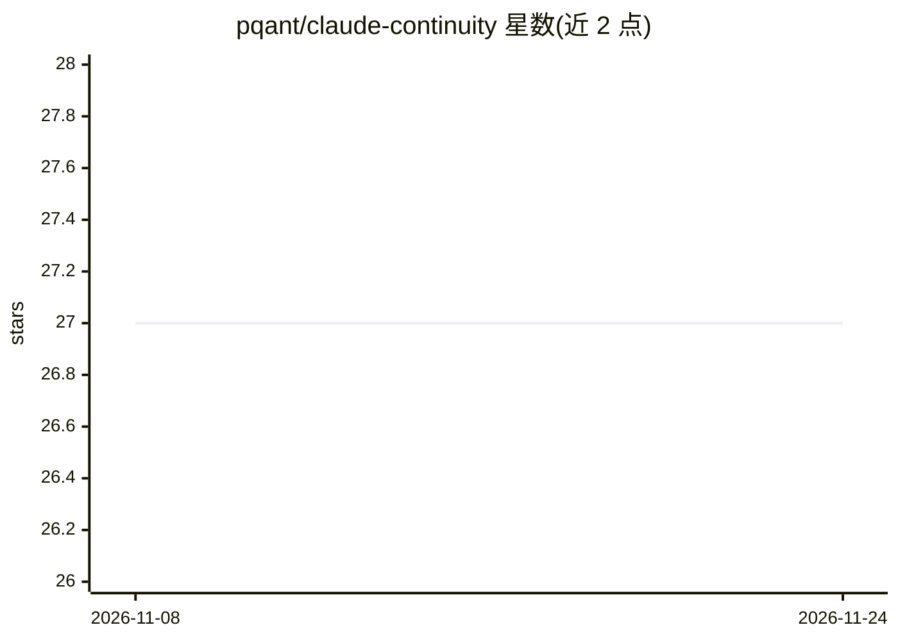

# pqant/claude-continuity

⭐ 27 · Python · MIT · 推送 2026-11-23 · [GitHub](https://github.com/pqant/claude-continuity) · 个人维护

**Claude Code 的零接触会话轮换与监护工具**

面向 Claude Code CLI 的会话连续性管理工具：监控上下文占用比例，达到阈值（默认 55% 警告 / 62% 轮换 / 72% 硬顶）时零接触完成会话轮换——完成当前步骤、写入经校验的 handoff、用 refs/continuity/* 快照 git 树、清空上下文并注入续接提示启动后继会话。可选 watchdog 守护进程在模型服务器（如本地 vLLM）死机时保持长任务可恢复，可选 ntfy 推送生命周期事件到手机。以 pipx/uv 安装的 Python CLI 形式提供，运行时仅依赖标准库，需 tmux、curl 与 Python ≥3.11，支持 macOS 与 Windows WSL。

## 筛选速览

| 维度 | 判定 | 备注 |
|---|---|---|
| AI 角色 | `ai-ecosystem` | LLM/agent 周边工具 |
| 许可风险 | `permissive` | MIT |
| 部署形态 | `library` | 以包/库形式分发 |
| 模型依赖 | — | README 未给出锁定关系 |
| 硬件要求 | — | 无带数字的原话,不猜 |
| 安装摩擦 | `low` | 无编译、无系统依赖或容器化 |
| 成熟度 | — | 结构信号不足 |

## 能力要点

- 按上下文阈值自动轮换会话，以校验 handoff 替代有损压缩摘要
- watchdog 守护进程含模型服务器健康探测与会话活性分类
- ntfy 推送生命周期事件，内容经密钥脱敏
- 安装内容为可识别托管块，cc-continuity uninstall 可逆卸载

## 适用场景

- 让 agent 长时间驱动项目，窗口填满前自动轮换会话
- 无人值守跑长任务，模型服务器挂掉后自动恢复
- 在手机上通过推送监看长任务的进度与阻塞点

## 场景标签

`编码 Agent` · 领域:编码与开发

## 证据(README 行号)

> L18: Zero-touch session rotation and supervision for Claude Code.
> L24: cc-continuity watches the context ratio and, when it crosses a threshold, rotates the session with no user action:
> L34: An optional **watchdog** daemon keeps long unattended runs recoverable

## 星数曲线

2026-11-08 27 → 2026-11-24 27（+0）

---
*卡片 v1 · prompt 1.4 · 生成 2026-11-18 · 置信度 high · 依据 README sha `6951529bc131` · [字段定义](../../DATASET.md)*
