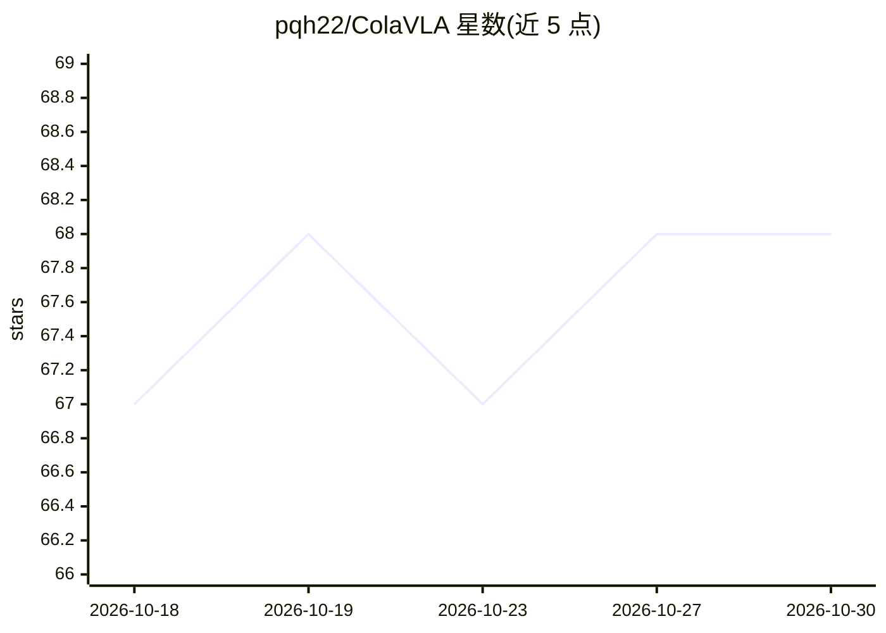

# pqh22/ColaVLA

⭐ 68 · Python · MIT · 推送 2026-03-26 · [GitHub](https://github.com/pqh22/ColaVLA) · [官网](https://pqh22.github.io/projects/ColaVLA/index.html) · 组织维护

**面向自动驾驶轨迹规划的视觉-语言-动作框架（CVPR2026 论文代码）**

清华大学、CUHK MMLab 与滴滴 Voyager Research 合作的研究项目，提供 CVPR2026 论文 ColaVLA 及 CVPR2025 论文 SOLVE 的训练与评测代码、模型权重和复现说明。ColaVLA 将链式推理从离散文本转移到紧凑潜空间，通过认知潜空间推理器生成 meta-action 嵌入，再由分层并行规划器在单次前向中解码多尺度轨迹，面向 nuScenes 开环与闭环评测。给自动驾驶规划方向的研究人员使用。

## 筛选速览

| 维度 | 判定 | 备注 |
|---|---|---|
| AI 角色 | `ai-native` | 本体是模型或模型工具 |
| 许可风险 | `permissive` | MIT |
| 部署形态 | `None` |  |
| 模型依赖 | — | README 未给出锁定关系 |
| 硬件要求 | — | 无带数字的原话,不猜 |
| 安装摩擦 | `low` | 无编译、无系统依赖或容器化 |
| 成熟度 | — | 结构信号不足 |

## 能力要点

- 将推理从文本链转移到紧凑潜空间的 Cognitive Latent Reasoning
- 分层并行规划器单次前向生成多尺度轨迹
- 同时开源 CVPR2025 SOLVE 框架的代码、配置与检查点
- 提供训练/评测脚本与模型权重

## 适用场景

- 在 nuScenes 上复现开环/闭环轨迹规划实验
- 研究潜空间推理范式在端到端自动驾驶中的应用
- 对比 VLM 与端到端模型协同（SOLVE）的规划方案

## 场景标签

`多模态` · 领域:感知与多模态

## 证据(README 行号)

> L24: **ColaVLA** is a unified vision–language–action framework for autonomous driving trajectory planning.
> L46: We propose **Cognitive Latent Reasoning** to relocate chain-of-thought from discrete text to a compact latent space
> L64: We report strong performance on nuScenes in both **open-loop** and **closed-loop** evaluations, with favorable effi

## 星数曲线

2026-10-18 67 → 2026-10-30 68（+1）

---
*卡片 v1 · prompt 1.4 · 生成 2026-10-24 · 置信度 high · 依据 README sha `e09b01a660c6` · [字段定义](../../DATASET.md)*
