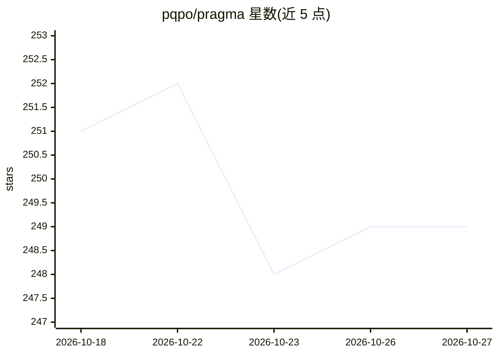

# pqpo/pragma

⭐ 249 · TypeScript · AGPL-3.0 · 推送 2026-10-26 · [GitHub](https://github.com/pqpo/pragma) · [官网](https://www.pqpo.me/2026/08/16/agent-team-builder-multi-harness-runtime/) · 个人维护 · 中文 README

**跨模型跨 harness 的可移植 Agent Team 构建运行平台**

面向开发者的 agent 团队平台：用 YAML DSL 组合 Experts、ExpertTeams、Flows、工具、Skills、共享上下文与记忆，形成可版本化、可导出为 .pragma 包的 Agent Team。提供三层使用方式：macOS Desktop 工作台、终端 CLI（npm 包，macOS/Windows）、以及经 @pragma/interpreter/@pragma/core 嵌入自有系统的 SDK。支持 Claude Code、Codex、PI、Qoder CLI、Antigravity 等运行时适配器，记忆通过证据流水线转为知识与技能。项目处于 preview 阶段，AGPL-3.0 许可。

## 筛选速览

| 维度 | 判定 | 备注 |
|---|---|---|
| AI 角色 | `ai-ecosystem` | LLM/agent 周边工具 |
| 许可风险 | `viral` | AGPL-3.0 |
| 部署形态 | `library` | 以包/库形式分发 |
| 模型依赖 | — | README 未给出锁定关系 |
| 硬件要求 | — | 无带数字的原话,不猜 |
| 安装摩擦 | `low` | 无编译、无系统依赖或容器化 |
| 成熟度 | `idea` | |

## 能力要点

- YAML DSL 定义可移植 Agent Team，可导出导入 .pragma bundle
- Desktop/CLI/SDK 三种构建运行方式
- 运行时适配器覆盖 Claude Code、Codex、PI、Qoder CLI、Antigravity
- 共享 ContextStore 与记忆流水线，将经验转为知识与技能

## 适用场景

- 一次构建 Agent Team，在 Codex、Claude Code 等工具间复用
- 用 SDK 把可移植 agent 团队嵌入自己的 AI 系统
- 在 Desktop 中配置多专家工作流并执行与审计 Mission

## 场景标签

`Agent 框架` `Agent 记忆` `多智能体` · 领域:Agent 开发

## 证据(README 行号)

> L9:  Build portable AI agent teams across models and harnesses — combine the right models, tools, context, and workflows
> L23: Unlike a single chat product or Coding Agent, Pragma treats the Agent Team and its working method as the portable u
> L146: Save an Agent Team as versioned YAML DSL, load and compile it with `@pragma/interpreter`, and invoke the compiled 

## 星数曲线

2026-10-18 251 → 2026-10-27 249（-2）

---
*卡片 v1 · prompt 1.4 · 生成 2026-10-22 · 置信度 high · 依据 README sha `76d950d5467c` · [字段定义](../../DATASET.md)*
