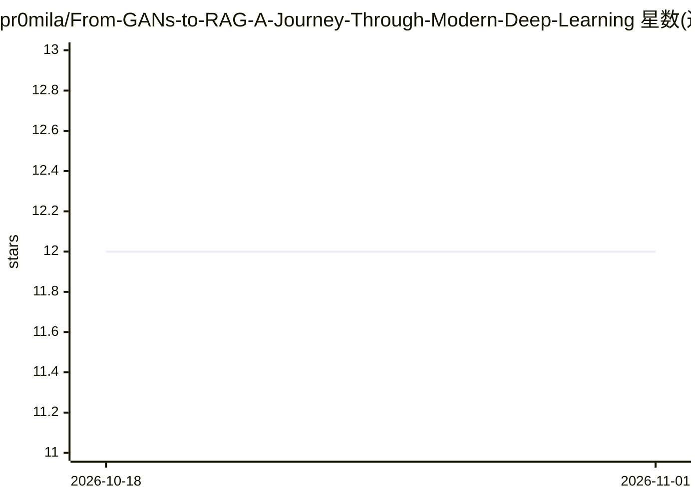

# pr0mila/From-GANs-to-RAG-A-Journey-Through-Modern-Deep-Learning

⭐ 12 · MIT · 推送 2025-12-13 · [GitHub](https://github.com/pr0mila/From-GANs-to-RAG-A-Journey-Through-Modern-Deep-Learning) · 个人维护

**深度学习论文阅读路径清单：从 GAN 到 RAG 的 14 篇论文**

策展式论文阅读清单：按概念演进组织 14 篇论文，从 GAN/VAE 生成基础、Transformer 架构、BERT/RoBERTa 预训练、ViT、扩散模型，到 LLaMA、Mixtral、LoRA 与 RAG 系列。每篇附年份、贡献说明与阅读链接，并提供面向学生、研究者、实践者的三条使用路径与快速参考表。仓库含 papers/ 目录结构供存放 PDF，接受 issue 与 PR 贡献，MIT 许可（论文版权归原作者）。

## 筛选速览

| 维度 | 判定 | 备注 |
|---|---|---|
| AI 角色 | `ai-knowledge` | 知识聚合/清单类 |
| 许可风险 | `permissive` | MIT |
| 部署形态 | `None` |  |
| 模型依赖 | — | README 未给出锁定关系 |
| 硬件要求 | — | 无带数字的原话,不猜 |
| 安装摩擦 | `low` | 无编译、无系统依赖或容器化 |
| 成熟度 | — | 结构信号不足 |

## 能力要点

- 14 篇论文按概念演进分为五个部分组织
- 提供学生/研究者/实践者三种阅读路径
- 附快速参考表、可视化时间线与论文关联图
- 补充 Hugging Face、Karpathy、Fast.ai 等外部学习资源

## 适用场景

- 按顺序系统学习从生成模型到 RAG 的深度学习演进
- 研究者快速定位某方向（如 Transformer、LoRA、RAG）的奠基论文
- 实践者挑选微调与 RAG 相关论文入门落地技术

## 场景标签

`精选清单` · 领域:学习与行业

## 证据(README 行号)

> L3: *A curated collection of foundational papers tracing the evolution from early generative models to modern retrieval-
> L11: This repository presents a carefully structured reading path through 14 landmark papers that tell the story of mode
> L24: ## 📚 The Papers

## 星数曲线

2026-10-18 12 → 2026-11-01 12（+0）

---
*卡片 v1 · prompt 1.4 · 生成 2026-11-01 · 置信度 high · 依据 README sha `3524c479759d` · [字段定义](../../DATASET.md)*
