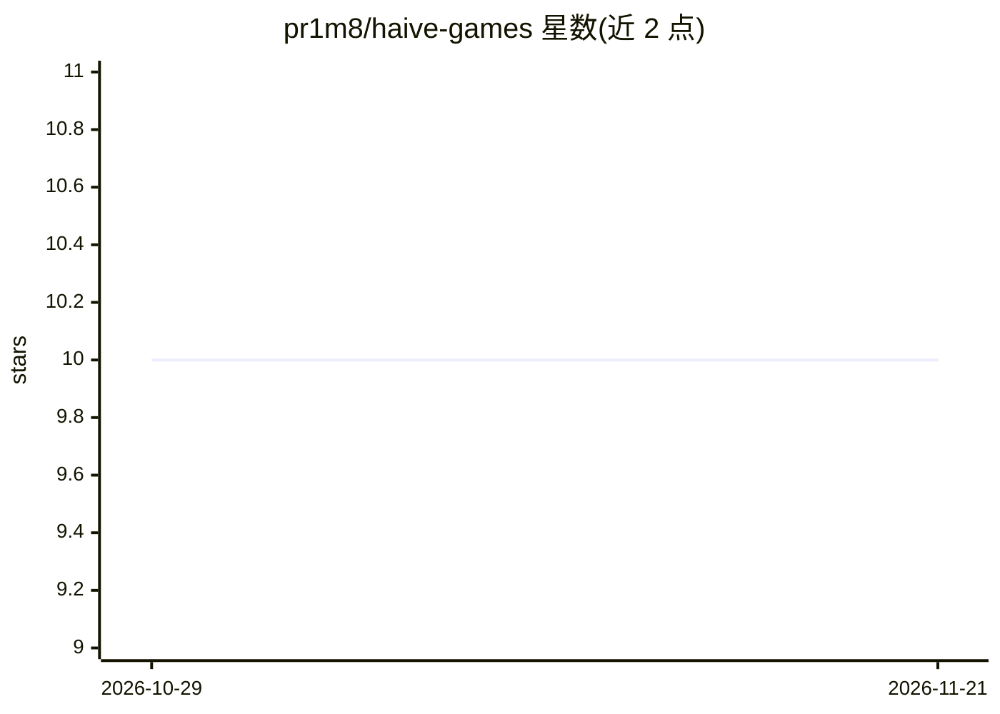

# pr1m8/haive-games

⭐ 10 · Python · 推送 2026-04-29 · [GitHub](https://github.com/pr1m8/haive-games) · [官网](https://pypi.org/project/haive-games/) · 个人维护

**供研究者用 LLM 智能体在 23 个游戏环境中对弈评测的框架**

一套游戏环境套件，让 LLM 智能体相互（或自我）对弈，覆盖国际象棋、围棋、德州扑克、社交推理等 23 个已实现的游戏。每个游戏包含状态管理器、基于角色的玩家智能体、提示模板与端到端流程；统一抽象为 GameStateManager、GameAgent、MultiPlayerGameAgent 三层，多玩家游戏可为不同角色配置不同模型。定位用途包括智能体评测、强化学习研究、多智能体基准测试。以 Python 包形式分发，MIT 许可，依赖 haive-core 与 haive-agents。

## 筛选速览

| 维度 | 判定 | 备注 |
|---|---|---|
| AI 角色 | `ai-ecosystem` | LLM/agent 周边工具 |
| 许可风险 | `permissive` | — |
| 部署形态 | `library` | 以包/库形式分发 |
| 模型依赖 | — | README 未给出锁定关系 |
| 硬件要求 | — | 无带数字的原话,不猜 |
| 安装摩擦 | `low` | 无编译、无系统依赖或容器化 |
| 成熟度 | — | 结构信号不足 |

## 能力要点

- 23 个已实现的游戏环境（棋类、社交推理、卡牌、解谜）
- 统一的三层抽象：GameStateManager / GameAgent / MultiPlayerGameAgent
- 多玩家游戏支持按角色配置不同 LLM（如 GPT-4 执白、Claude 执黑）
- 状态管理器提供真实合法走法与结果，作为评测基准

## 适用场景

- 让不同 LLM 在同一棋类环境中头对头对比评测
- 用 Among Us、Mafia 等游戏研究欺骗与推理能力
- 用 Chess/Go/Risk 测试长程规划能力
- 作为强化学习或多智能体研究的实验环境

## 场景标签

`多智能体` `模型评测` `强化学习` · 领域:Agent 开发

## 证据(README 行号)

> L12: A curated suite of game environments where LLM agents play against each other (or themselves). Each game is a compl
> L24: `haive-games` provides 23 working game environments with the framework already built. You configure the LLMs, run a
> L133: ### Agent Evaluation

## 星数曲线

2026-10-29 10 → 2026-11-21 10（+0）

---
*卡片 v1 · prompt 1.4 · 生成 2026-11-19 · 置信度 high · 依据 README sha `ffeebe549992` · [字段定义](../../DATASET.md)*
