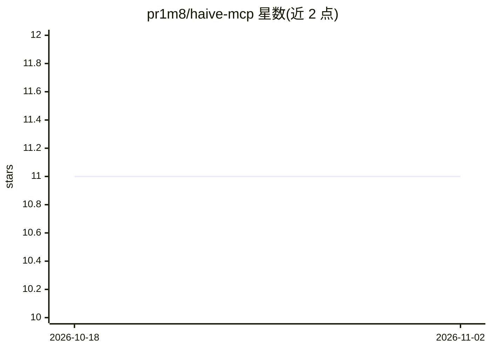

# pr1m8/haive-mcp

⭐ 11 · Python · 推送 2026-04-29 · [GitHub](https://github.com/pr1m8/haive-mcp) · [官网](https://pypi.org/project/haive-mcp/) · 个人维护

**让 AI agent 运行时发现并安装 MCP 服务器工具的集成库**

Python 库，作为 MCP 生态与 Haive agent 框架之间的桥接层：agent 可按能力搜索 1,960+ MCP 服务器注册表，经 human-in-the-loop（HITL）审批后安装新服务器，并把 MCP 工具封装为标准 LangChain 工具使用。支持四种传输方式（STDIO/SSE/Streamable HTTP/Docker），提供静态配置、动态发现（IntelligentMCPAgent 自动为任务发现工具）与 CLI 三种用法，可用 Docker 容器隔离运行不受信任的服务器。面向构建 agent 应用的开发者。

## 筛选速览

| 维度 | 判定 | 备注 |
|---|---|---|
| AI 角色 | `ai-ecosystem` | LLM/agent 周边工具 |
| 许可风险 | `permissive` | — |
| 部署形态 | `library` | 以包/库形式分发 |
| 模型依赖 | — | README 未给出锁定关系 |
| 硬件要求 | — | 无带数字的原话,不猜 |
| 安装摩擦 | `low` | 无编译、无系统依赖或容器化 |
| 成熟度 | — | 结构信号不足 |

## 能力要点

- 按能力搜索 1,960+ MCP 服务器注册表
- HITL 审批门控服务器安装
- MCP 工具封装为标准 LangChain 工具
- 四种传输方式：STDIO/SSE/Streamable HTTP/Docker

## 适用场景

- 让 agent 按需动态发现并安装工具，避免预装冗余工具库
- 通过审批流程控制 agent 实际安装哪些 MCP 服务器
- 在 Docker 容器中隔离运行不受信任的 MCP 服务器

## 场景标签

`Agent 框架` · 领域:Agent 开发

## 证据(README 行号)

> L10: **Dynamic MCP integration for AI agents** — search 1,960+ servers, install with HITL approval, connect via LangChai
> L12: `haive-mcp` enables runtime discovery and integration of tools from the **Model Context Protocol (MCP)** ecosystem.
> L18: `haive-mcp` is the bridge between MCP and the Haive agent framework. It provides:

## 星数曲线

2026-10-18 11 → 2026-11-02 11（+0）

---
*卡片 v1 · prompt 1.4 · 生成 2026-11-01 · 置信度 mid · 依据 README sha `217da8111e87` · [字段定义](../../DATASET.md)*
