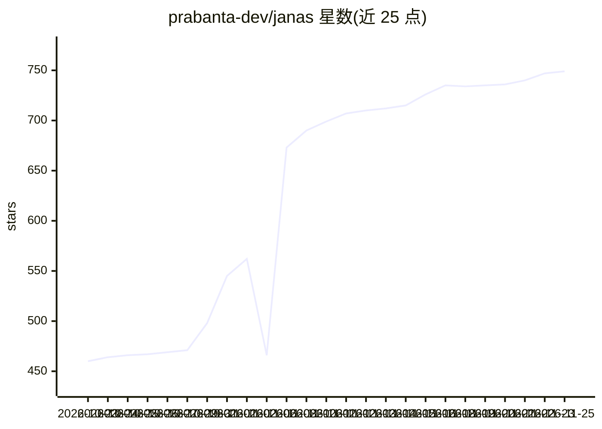

# prabanta-dev/janas

⭐ 749 · C · GPL-3.0 · 推送 2026-11-24 · [GitHub](https://github.com/prabanta-dev/janas) · 个人维护

**本地 C 语言推理引擎：让超出内存的大模型在笔记本 CPU/GPU 上运行**

以 C 编写、仅依赖 C 标准库的本地大模型工具族，包含推理引擎 Janas-LLM、桌面应用 Brebus、终端聊天 janas-chat、兼容 OpenAI/Ollama/Anthropic API 的 janas-server、模型下载与基准工具及一组 MCP 服务。核心机制是自动探测机器的内存、CPU、GPU（Vulkan）与 Intel NPU，模型装得下就整体加载，装不下则把 MoE 专家从 NVMe SSD 按需流式读取。面向想在自有硬件上运行大模型的用户。限制：仅支持 Linux 与 Windows x86-64，处于早期阶段，版本每周多次更新，C API 与命令行仍在变动。

## 筛选速览

| 维度 | 判定 | 备注 |
|---|---|---|
| AI 角色 | `ai-ecosystem` | LLM/agent 周边工具 |
| 许可风险 | `viral` | GPL-3.0 |
| 部署形态 | `desktop` | 安装包/桌面程序 |
| 模型依赖 | local-ok | 支持本地模型 |
| 硬件要求 | — | 无带数字的原话,不猜 |
| 安装摩擦 | `medium` | 含编译或系统依赖之一 |
| 成熟度 | `idea` | |

## 能力要点

- MoE 专家从 NVMe 流式读取，可在小于模型体积的内存上运行
- 自动测量内存/CPU/GPU/NPU 并选择运行方式，结果跨启动保留
- HTTP API 同时兼容 OpenAI、Ollama 与 Anthropic 三种格式
- 提供 C、FreeBASIC、Node.js 库及 MCP 服务与客户端

## 适用场景

- 在 32 GB 内存的笔记本上运行 80B 级别的 MoE 模型
- 为编辑器与代码补工具提供本地 OpenAI 兼容 API
- 在终端或桌面应用中与本地模型聊天并接入文档检索

## 场景标签

`推理引擎` `AI 助手` · 领域:对话与助手

## 证据(README 行号)

> L26: Janas is a family of tools for artificial intelligence, written in C with no dependencies beyond the C library, by 
> L32: Runs large language models, mixtures of experts above all, on whatever machine it finds, from a modest laptop to a 
> L53: The model behind an HTTP API that follows OpenAI's, Ollama's and Anthropic's (Claude Code), for editors and other p

## 星数曲线

2026-10-23 460 → 2026-11-25 749（+289）

---
*卡片 v1 · prompt 1.4 · 生成 2026-11-25 · 置信度 high · 依据 README sha `32d37b6df741` · [字段定义](../../DATASET.md)*
