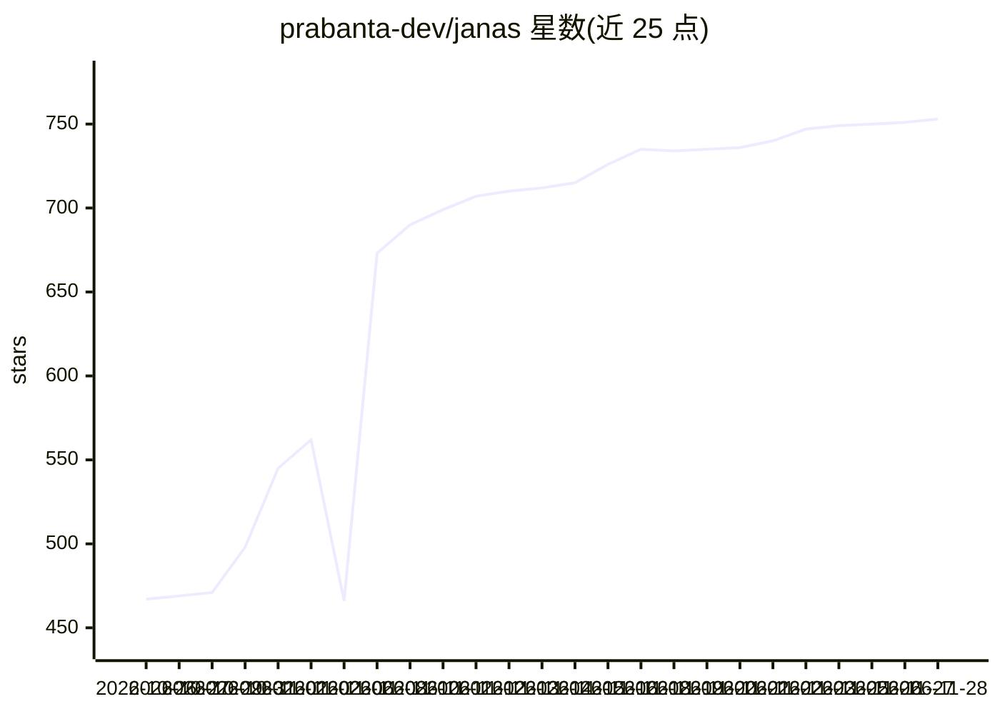

# prabanta-dev/janas

⭐ 753 · C · GPL-3.0 · 推送 2026-11-26 · [GitHub](https://github.com/prabanta-dev/janas) · 个人维护

**纯 C 的本地 LLM 推理引擎：让超过内存的大模型在笔记本上运行**

一个用 C 编写、除 C 标准库外无依赖的 AI 工具族：核心是 Janas-LLM 推理引擎，自动探测机器的内存、CPU、GPU（Vulkan）与 Intel NPU 并选择运行方式；对超过 RAM 的 MoE 模型，从 NVMe SSD 流式读取专家并缓存热专家。附带终端聊天 janas-chat（MCP 工具、草稿加速）、兼容 OpenAI/Ollama/Anthropic API 的 janas-server、模型下载与转换工具，以及桌面应用 Brebus（本地文档 RAG、artifacts、语音）。提供 Linux/Windows/macOS 预编译包，可从源码构建；作者声明项目处于早期阶段，仅测试过有限硬件。

## 筛选速览

| 维度 | 判定 | 备注 |
|---|---|---|
| AI 角色 | `ai-ecosystem` | LLM/agent 周边工具 |
| 许可风险 | `viral` | GPL-3.0 |
| 部署形态 | `desktop` | 安装包/桌面程序 |
| 模型依赖 | local-ok | 支持本地模型 |
| 硬件要求 | — | 无带数字的原话,不猜 |
| 安装摩擦 | `medium` | 含编译或系统依赖之一 |
| 成熟度 | `idea` | |

## 能力要点

- MoE 专家从 NVMe 流式读取，模型可大于物理内存
- 自动测量内存/CPU/GPU/NPU 并缓存测量结果供下次启动
- janas-server 提供兼容 OpenAI、Ollama、Anthropic 的 HTTP API 及 embeddings、语音转文字
- 提供 C、FreeBASIC、Node.js 库及自有 MCP 服务（文档、文件、网页、地图等）

## 适用场景

- 在 32 GB 笔记本上运行 48 GB 级别的 Qwen MoE 模型
- 为编辑器和代码补程序提供本地 OpenAI 兼容 API
- 用 Brebus 在本地对话并检索自己的 PDF/Office/EPUB 文档
- 把模型以 MCP 工具形式接入 Claude Code 等客户端

## 场景标签

`推理引擎` `RAG` · 领域:知识与检索

## 证据(README 行号)

> L27: Janas is a family of tools for artificial intelligence, written in C with no dependencies beyond the C library, by 
> L31: ### Janas-LLM, the engine
> L54: The model behind an HTTP API that follows OpenAI's, Ollama's and Anthropic's (Claude Code), for editors and other p

## 星数曲线

2026-10-26 467 → 2026-11-28 753（+286）

---
*卡片 v1 · prompt 1.4 · 生成 2026-11-26 · 置信度 high · 依据 README sha `ad4d257c2373` · [字段定义](../../DATASET.md)*
