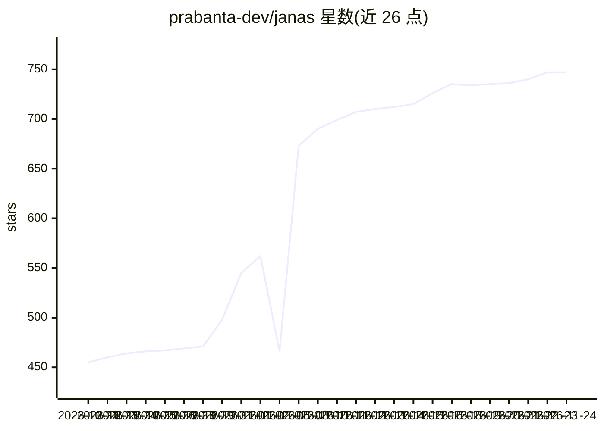

# prabanta-dev/janas

⭐ 749 · C · GPL-3.0 · 推送 2026-11-24 · [GitHub](https://github.com/prabanta-dev/janas) · 个人维护

**纯 C 本地 LLM 推理引擎：RAM 装不下的 MoE 模型也能跑**

Janas 是一组用 C 编写、除 C 标准库外无依赖的 AI 工具家族，包含推理引擎 Janas-LLM、桌面应用 Brebus、终端聊天 janas-chat、兼容 OpenAI/Ollama/Anthropic API 的 janas-server、模型下载与基准测试工具及多个 MCP 服务。核心机制：打开模型时测量本机内存/CPU/GPU/NPU 自动选择运行方式；大于内存的 MoE 模型按 token 从 NVMe SSD 流式读取专家并缓存热点专家。支持 Linux 与 Windows x86-64，提供二进制下载与源码编译两种途径，GPL-3.0 许可，当前处于早期阶段、新版本每周发布多次。

## 筛选速览

| 维度 | 判定 | 备注 |
|---|---|---|
| AI 角色 | `ai-ecosystem` | LLM/agent 周边工具 |
| 许可风险 | `viral` | GPL-3.0 |
| 部署形态 | `desktop` | 安装包/桌面程序 |
| 模型依赖 | local-ok | 支持本地模型 |
| 硬件要求 | — | 无带数字的原话,不猜 |
| 安装摩擦 | `medium` | 含编译或系统依赖之一 |
| 成熟度 | `idea` | |

## 能力要点

- MoE 模型大于内存时从 NVMe SSD 流式读取专家，热点专家驻留内存
- 启动时测量内存/CPU/GPU/NPU 并自动选择执行路径，结果留存下次启动
- HTTP API 同时兼容 OpenAI、Ollama 与 Anthropic 三种格式
- 提供 C/FreeBASIC/Node.js 库接口与 MCP 服务（文档、文件、网页、Wikipedia 等）

## 适用场景

- 在 32GB 内存的笔记本上运行 48GB 的 Qwen3-Next-80B 模型
- 给本地编辑器（Continue/Cline/Zed 等）提供光标处代码补全
- 通过 Brebus 在本地离线聊天并检索自己文件夹中的 PDF/Office 文档
- 用 janas-bench 测量并分享本机运行大模型的性能报告

## 场景标签

`推理引擎` `代码生成` `模型评测` `文档问答` · 领域:编码与开发

## 证据(README 行号)

> L26: Janas is a family of tools for artificial intelligence, written in C with no dependencies beyond the C library, by 
> L32: Runs large language models, mixtures of experts above all, on whatever machine it finds, from a modest laptop to a 
> L53: The model behind an HTTP API that follows OpenAI's, Ollama's and Anthropic's (Claude Code), for editors and other p

## 星数曲线

2026-10-22 455 → 2026-11-24 747（+292）

---
*卡片 v1 · prompt 1.4 · 生成 2026-11-24 · 置信度 high · 依据 README sha `6f5e839fc483` · [字段定义](../../DATASET.md)*
