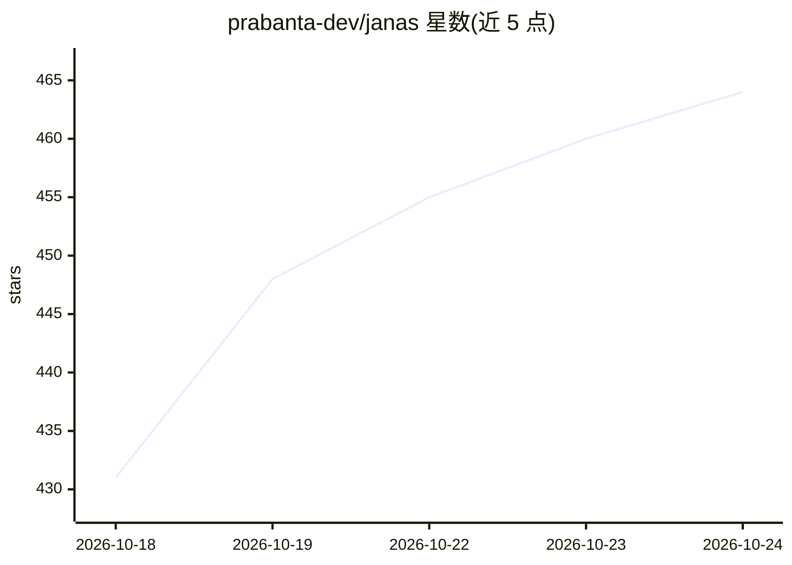

# prabanta-dev/janas

⭐ 464 · C · GPL-3.0 · 推送 2026-10-23 · [GitHub](https://github.com/prabanta-dev/janas) · 个人维护

**纯 C 编写的本地 LLM 推理引擎，跑超出内存的大 MoE 模型**

Janas-LLM 是 Janas 工具族的首个组件，用 C 编写、仅依赖 C 标准库，在普通电脑（含无 GPU 情形）上运行大型混合专家语言模型：权重保留在磁盘上，按 token 所需的专家从 NVMe SSD 流式读取，常驻专家留在内存与缓存中，使 48 GB 的 80B 模型可在 32 GB 内存的笔记本上运行。支持 CPU（AVX2/FMA/AVX-VNNI）与集成 GPU、投机草稿加速。README 声明为实验项目：仅在一台机器上开发测试，API 与命令行频繁变动，引擎会占满空闲内存并以 O_DIRECT 全速读盘，可能导致系统卡顿。提供 Linux/Windows x86-64 预编译二进制。

## 筛选速览

| 维度 | 判定 | 备注 |
|---|---|---|
| AI 角色 | `ai-ecosystem` | LLM/agent 周边工具 |
| 许可风险 | `viral` | GPL-3.0 |
| 部署形态 | `desktop` | 安装包/桌面程序 |
| 模型依赖 | — | README 未给出锁定关系 |
| 硬件要求 | — | 无带数字的原话,不猜 |
| 安装摩擦 | `medium` | 含编译或系统依赖之一 |
| 成熟度 | `idea` | |

## 能力要点

- 权重驻留磁盘、专家从 NVMe 流式加载，可运行大于内存的 MoE 模型
- 纯 C 实现，除 C 标准库外无依赖
- 支持集成 GPU 的快速 prompt 处理与草稿投机加速（--mtp/--draft）
- 提供 janas-chat 交互、janas-bench 基准测量，Linux 与 Windows x86-64 二进制下载

## 适用场景

- 在 32 GB 内存笔记本上运行 80B 级 MoE 模型进行本地对话
- 测量本机各模型读写速度（janas-bench）
- 研究超出内存的大模型磁盘流式推理方案

## 场景标签

`推理引擎` · 领域:训练与推理

## 证据(README 行号)

> L55: Janas is a family of tools for artificial intelligence, written in C with no dependencies beyond the C library. Its
> L61: **This is an experiment, not a product.**

## 星数曲线

2026-10-18 431 → 2026-10-24 464（+33）

---
*卡片 v1 · prompt 1.4 · 生成 2026-10-21 · 置信度 high · 依据 README sha `3928ac4d373d` · [字段定义](../../DATASET.md)*
