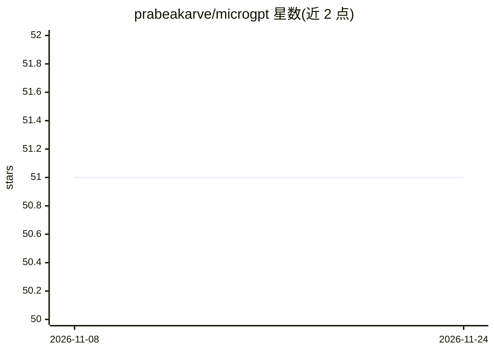

# prabeakarve/microgpt

⭐ 51 · Python · MIT · 推送 2026-11-05 · [GitHub](https://github.com/prabeakarve/microgpt) · 个人维护 · 中文 README

**给学习者的纯 NumPy 从零实现 GPT：可读可训练的语言模型**

用约 700 行纯 NumPy 从第一性原理实现 decoder-only Transformer 语言模型，无框架、无 autograd，所有梯度手写并标注形状，含字节级分词器、多头自注意力、AdamW 训练器（warmup+cosine 调度）与 top-k 采样。提供 CLI（train/sample/next/eval）与 Python 库接口（GPT、train、complete、perplexity）。在笔记本 CPU 上约一分钟可完成训练，训练语料约 8 KB。依赖仅 Python 3.10+ 与 NumPy，通过 git clone 加 pip -e 安装，附梯度检查单元测试。

## 筛选速览

| 维度 | 判定 | 备注 |
|---|---|---|
| AI 角色 | `ai-native` | 本体是模型或模型工具 |
| 许可风险 | `permissive` | MIT |
| 部署形态 | `library` | 以包/库形式分发 |
| 模型依赖 | — | README 未给出锁定关系 |
| 硬件要求 | — | 无带数字的原话,不猜 |
| 安装摩擦 | `low` | 无编译、无系统依赖或容器化 |
| 成熟度 | — | 结构信号不足 |

## 能力要点

- 全部梯度手写推导，无框架无 autograd
- 字节级分词器、多头自注意力、AdamW 与 top-k 采样完整实现
- 提供 CLI 与库接口（训练、采样、next-token 检查、困惑度）
- 笔记本 CPU 约一分钟即可完成训练

## 适用场景

- 通读代码理解注意力、反向传播、优化器与采样策略的工作机制
- 在本机小语料上训练并采样一个小型 GPT
- 用梯度检查验证手写反向传播的正确性

## 场景标签

`教程课程` · 领域:学习与行业

## 证据(README 行号)

> L5: MicroGPT is a decoder-only Transformer language model implemented from first principles.
> L6: Every gradient is derived by hand, every shape is annotated, and the whole thing trains on a
> L7: laptop CPU in about a minute. It exists for one reason: to make the machinery of modern

## 星数曲线

2026-11-08 51 → 2026-11-24 51（+0）

---
*卡片 v1 · prompt 1.4 · 生成 2026-11-18 · 置信度 mid · 依据 README sha `ffdaac8801a8` · [字段定义](../../DATASET.md)*
