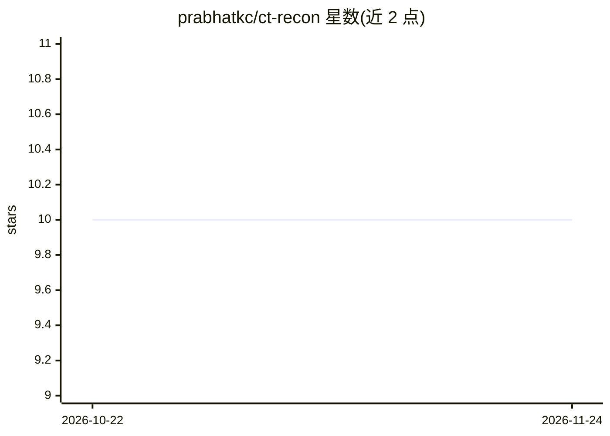

# prabhatkc/ct-recon

⭐ 10 · Python · 推送 2026-06-09 · [GitHub](https://github.com/prabhatkc/ct-recon) · 个人维护

**医学图像前向与逆过程算法的 Python 实现库**

ct-recon 将医学图像前向与逆过程（如断层重建、去噪、噪声插入）中的多种算法集中提供，供用户以即插即用方式按自身应用选用，并附带传统与新型误差分析技术。实现以 Python 为主、部分为 MATLAB，主题标签涉及 CT 去噪、迭代去噪、双边滤波与分布式训练。README 内容较简略，具体算法清单以图示说明，安装与运行方式未在可见文本中给出。

## 筛选速览

| 维度 | 判定 | 备注 |
|---|---|---|
| AI 角色 | `ai-native` | 本体是模型或模型工具 |
| 许可风险 | `none` | — |
| 部署形态 | `None` |  |
| 模型依赖 | — | README 未给出锁定关系 |
| 硬件要求 | — | 无带数字的原话,不猜 |
| 安装摩擦 | `low` | 无编译、无系统依赖或容器化 |
| 成熟度 | — | 结构信号不足 |

## 能力要点

- 集中提供医学图像前向与逆过程算法
- 算法以即插即用方式供调用
- 附带误差分析技术
- 提供 Python 及部分 MATLAB 实现

## 适用场景

- 医学 CT 图像的去噪与重建实验
- 在自有流程中即插即用接入重建/去噪算法
- 对重建结果做误差分析

## 场景标签

 · 领域:生物医学成像/计算机视觉

## 证据(README 行号)

> L3: 1. The objective of **ct-recon** is to make different algorithms used in forward & inverse processes of medical imag
> L4: 2. Then one make use of these algorithms in a plug-n-play manner in accordance to his/her need/application.

## 星数曲线

2026-10-22 10 → 2026-11-24 10（+0）

---
*卡片 v1 · prompt 1.4 · 生成 2026-11-19 · 置信度 low · 依据 README sha `2db41a5c341b` · [字段定义](../../DATASET.md)*
