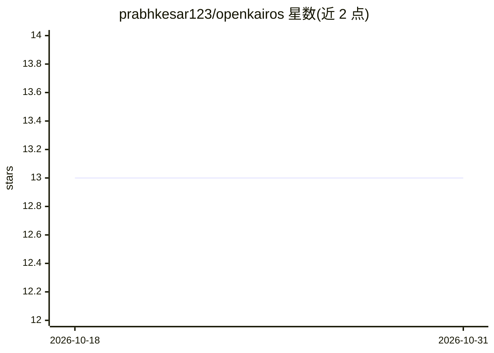

# prabhkesar123/openkairos

⭐ 13 · Python · MIT · 推送 2026-04-27 · [GitHub](https://github.com/prabhkesar123/openkairos) · [官网](https://pypi.org/project/openkairos) · 个人维护

**常驻后台的自主 AI 编码守护进程：持续监控代码库并自主行动**

Python 实现的后台守护进程，每 5 分钟唤醒扫描仓库、评估 git diff，自主执行 LLM agent 循环：标记漏洞与 TODO/FIXME、运行测试、生成修复或架构总结。维护三层持久记忆（索引、主题文件、追加日志），空闲 30 分钟以上时进入 AutoDream 周期压缩知识。支持 Telegram/macOS/终端通知、GitHub Webhook 深度审计与 MCP 集成，提供 watch 观察（默认）与 task 目标驱动两种模式。模型无关，自带 API key 即可用，CLI 命令含 kairos watch/task/brief 等。

## 筛选速览

| 维度 | 判定 | 备注 |
|---|---|---|
| AI 角色 | `ai-native` | 本体是模型或模型工具 |
| 许可风险 | `permissive` | MIT |
| 部署形态 | `library` | 以包/库形式分发 |
| 模型依赖 | local-ok | 支持本地模型 |
| 硬件要求 | — | 无带数字的原话,不猜 |
| 安装摩擦 | `low` | 无编译、无系统依赖或容器化 |
| 成熟度 | — | 结构信号不足 |

## 能力要点

- 每 5 分钟 Tick 引擎扫描仓库并自主决策行动
- 三层持久记忆与空闲 AutoDream 知识压缩
- 模型无关：Anthropic/OpenAI/DeepSeek/Gemini/本地 Ollama 按环境变量自动检测
- 内置 MCP JSON-RPC server 与 GitHub Webhook 接入

## 适用场景

- 夜间无人值守时让守护进程修复失败测试并推送 Telegram 晨报
- 提交前拦截泄露的 API key 与 SQL 注入等漏洞
- 持续消化代码库中的 TODO/FIXME 技术债并生成重构 PR

## 场景标签

`编码 Agent` `代码审查` · 领域:编码与开发

## 证据(README 行号)

> L43: OpenKairos is an **autonomous background daemon** powered by AI. Unlike traditional AI coding assistants that wait 
> L175: - **Agent Loop (LLM)** → the brain

## 星数曲线

2026-10-18 13 → 2026-10-31 13（+0）

---
*卡片 v1 · prompt 1.4 · 生成 2026-10-31 · 置信度 high · 依据 README sha `a4953123d430` · [字段定义](../../DATASET.md)*
