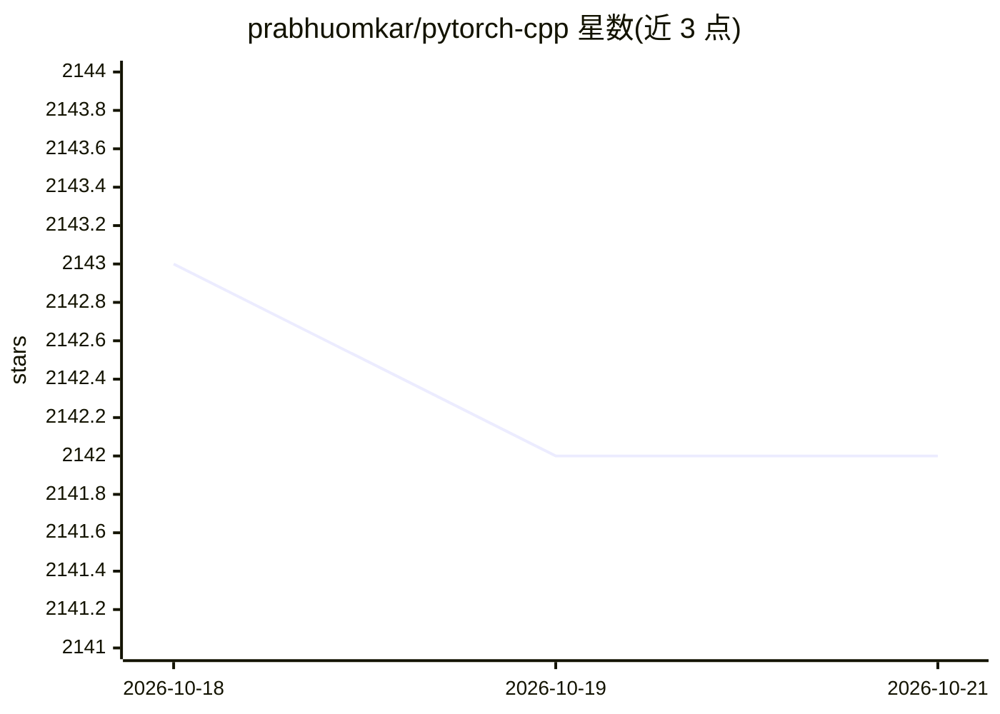

# prabhuomkar/pytorch-cpp

⭐ 2,142 · C++ · MIT · 推送 2026-09-13 · [GitHub](https://github.com/prabhuomkar/pytorch-cpp) · 个人维护

**PyTorch 官方教程的 C++/LibTorch 实现合集**

将 PyTorch 教程用 C++（LibTorch）重新实现的教学仓库，覆盖基础（线性回归、前馈网络）、中级（CNN、ResNet、RNN、语言模型）、高级（GAN、VAE、风格迁移、图像描述）及交互式教程（Tensor Slicing，基于 xeus-cling 在 notebook 中运行）。通过 CMake 生成构建系统，支持按类别或单个教程构建，可自动下载 LibTorch、数据集与预训练 scriptmodule，支持 CUDA 版本选择。面向希望用 C++ 学习深度学习的学习者，提供本地构建、Google Colab 与 Docker 三种使用方式，要求 C++17 编译器、CMake 与 LibTorch。

## 筛选速览

| 维度 | 判定 | 备注 |
|---|---|---|
| AI 角色 | `ai-knowledge` | 知识聚合/清单类 |
| 许可风险 | `permissive` | MIT |
| 部署形态 | `desktop` | 安装包/桌面程序 |
| 模型依赖 | — | README 未给出锁定关系 |
| 硬件要求 | — | 无带数字的原话,不猜 |
| 安装摩擦 | `low` | 无编译、无系统依赖或容器化 |
| 成熟度 | — | 结构信号不足 |

## 能力要点

- PyTorch 教程的 C++（LibTorch）实现，按 basics/intermediate/advanced/popular 分类
- CMake 选项化构建：可选 CUDA 版本、自动下载数据集与预训练权重
- 交互式 C++ 教程（xeus-cling notebook）
- 提供 Google Colab、本地 CMake 构建与 Docker 三种运行途径

## 适用场景

- 用 C++ 而非 Python 学习 PyTorch 深度学习教程
- 了解 LibTorch 的模型训练与推理写法（CNN/GAN/VAE/图像描述等）
- 在 Docker 或 Colab 环境中免配置运行教程

## 场景标签

`教程课程` · 领域:学习与行业

## 证据(README 行号)

> L1: C++ Implementation of PyTorch Tutorials for Everyone
> L11: ### 1. Basics
> L34: * Deep Learning with PyTorch: A 60 Minute Blitz

## 星数曲线

2026-10-18 2,143 → 2026-10-21 2,142（-1）

---
*卡片 v1 · prompt 1.4 · 生成 2026-10-21 · 置信度 high · 依据 README sha `4d46e12949d4` · [字段定义](../../DATASET.md)*
