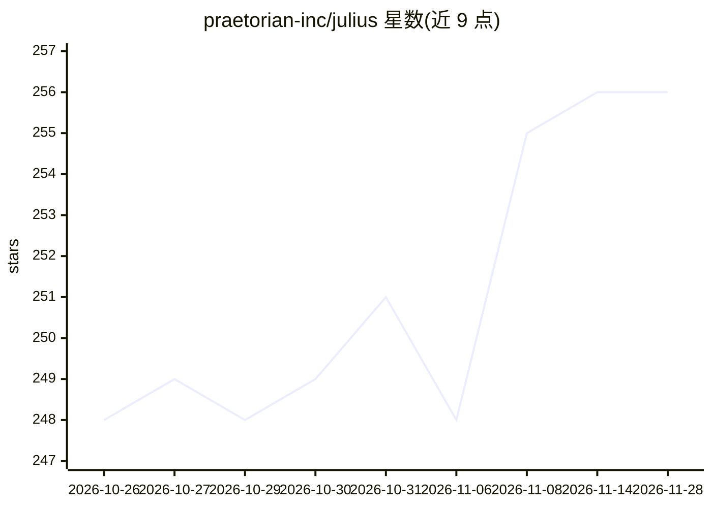

# praetorian-inc/julius

⭐ 256 · Go · Apache-2.0 · 推送 2026-11-23 · [GitHub](https://github.com/praetorian-inc/julius) · [官网](https://www.praetorian.com/blog/introducing-julius-open-source-llm-service-fingerprinting/) · 组织维护

**给安全人员识别网络端点上运行的 LLM 服务的指纹工具**

面向渗透测试与攻击面发现场景的 LLM 服务指纹识别工具：向目标端点发送 HTTP 探针，按响应签名匹配并识别运行的服务软件（自托管服务器、网关、MCP、RAG 平台、云服务共 65 类），给出 1-100 特异性评分，并可提取端点可用模型。区分服务识别与模型识别：回答"这个端口跑的是什么服务"而非"哪段文本由哪个模型生成"。仅发送标准 HTTP 请求，不利用漏洞、不绕过认证；以 Go 单二进制分发，离线运行，探针通过 YAML 文件扩展。

## 筛选速览

| 维度 | 判定 | 备注 |
|---|---|---|
| AI 角色 | `ai-ecosystem` | LLM/agent 周边工具 |
| 许可风险 | `permissive` | Apache-2.0 |
| 部署形态 | `library` | 以包/库形式分发 |
| 模型依赖 | local-ok | 支持本地模型 |
| 硬件要求 | — | 无带数字的原话,不猜 |
| 安装摩擦 | `low` | 无编译、无系统依赖或容器化 |
| 成熟度 | — | 结构信号不足 |

## 能力要点

- 识别 65 类 LLM 服务，覆盖自托管/网关/MCP/RAG/云五类
- 特异性评分 1-100 排序匹配结果（如 LiteLLM 优先于泛 OpenAI 兼容）
- YAML 探针文件扩展新服务检测，单二进制离线运行
- 支持单目标/文件/stdin 输入与 Table/JSON/JSONL 输出

## 适用场景

- 渗透测试中发现开放端口后确认是否为 Ollama 等服务
- 攻击面梳理时批量扫描资产中的 AI 服务端点
- 识别端点后进一步提取其可用模型清单

## 场景标签

`网络安全` · 领域:学习与行业

## 证据(README 行号)

> L12: **Julius** is an LLM service fingerprinting tool for security professionals. It detects which AI server software is
> L78: Julius identifies 65 LLM platforms across self-hosted, gateway, MCP, RAG/orchestration, and cloud-managed categorie

## 星数曲线

2026-10-26 248 → 2026-11-28 256（+8）

---
*卡片 v1 · prompt 1.4 · 生成 2026-11-25 · 置信度 high · 依据 README sha `4c60ecd83fdb` · [字段定义](../../DATASET.md)*
