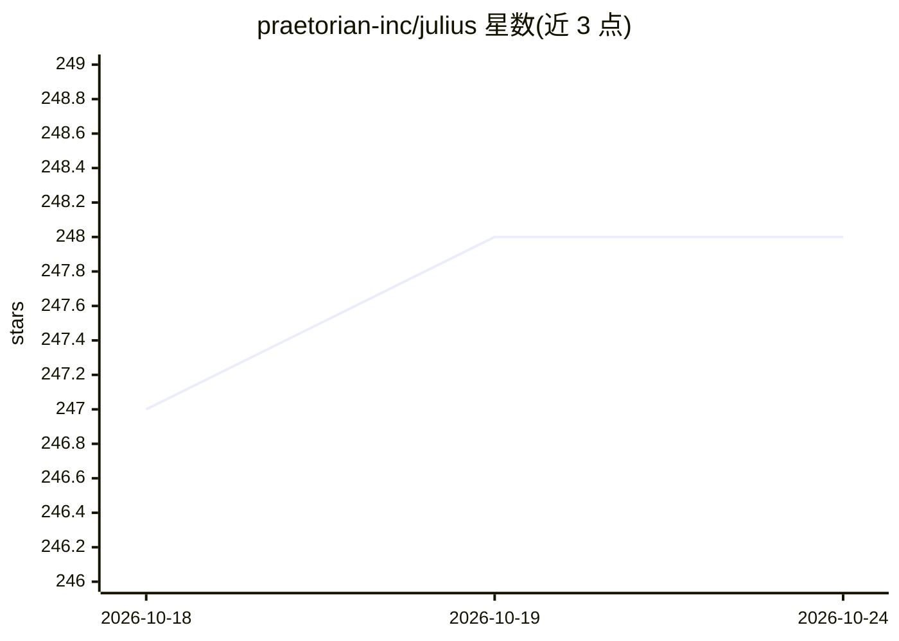

# praetorian-inc/julius

⭐ 248 · Go · Apache-2.0 · 推送 2026-10-03 · [GitHub](https://github.com/praetorian-inc/julius) · [官网](https://www.praetorian.com/blog/introducing-julius-open-source-llm-service-fingerprinting/) · 组织维护

**面向安全人员的 LLM 服务指纹识别工具：探测端点运行哪种 AI 服务**

Go 编写的命令行安全侦察工具：向目标端点发送针对性 HTTP 探测，依据响应签名（状态码、响应体、Header）匹配识别其运行的 LLM 服务端软件，覆盖 64 种服务（自托管、网关、MCP、RAG 编排、云托管五大类），并以 1-100 特异性评分排序结果，可提取端点可用模型列表。支持单目标/文件/stdin 输入与 Table/JSON/JSONL 输出，探测规则以 YAML 文件定义可扩展，编译为单一二进制、完全离线运行。面向渗透测试与攻击面评估场景，仅发送标准 HTTP 请求，不做漏洞利用。

## 筛选速览

| 维度 | 判定 | 备注 |
|---|---|---|
| AI 角色 | `ai-ecosystem` | LLM/agent 周边工具 |
| 许可风险 | `permissive` | Apache-2.0 |
| 部署形态 | `library` | 以包/库形式分发 |
| 模型依赖 | — | README 未给出锁定关系 |
| 硬件要求 | — | 无带数字的原话,不猜 |
| 安装摩擦 | `low` | 无编译、无系统依赖或容器化 |
| 成熟度 | — | 结构信号不足 |

## 能力要点

- 识别 64 种 LLM 服务端软件（Ollama、vLLM、LiteLLM、TGI 等）
- 1-100 特异性评分，优先返回最具体匹配
- 从已识别端点提取可用模型列表
- YAML 探测文件可扩展新服务，单一 Go 二进制离线运行

## 适用场景

- 渗透测试中判断开放端口运行的是哪种 LLM 服务
- 攻击面发现时批量扫描企业资产中的 AI 服务部署
- 安全评估后集成 JSON/JSONL 输出到报告流程

## 场景标签

`网络安全` · 领域:学习与行业

## 证据(README 行号)

> L12: **Julius** is an LLM service fingerprinting tool for security professionals. It detects which AI server software is
> L24: **Julius solves this by automatically fingerprinting LLM services** - sending targeted HTTP probes and matching res

## 星数曲线

2026-10-18 247 → 2026-10-24 248（+1）

---
*卡片 v1 · prompt 1.4 · 生成 2026-10-22 · 置信度 high · 依据 README sha `174a136628b2` · [字段定义](../../DATASET.md)*
