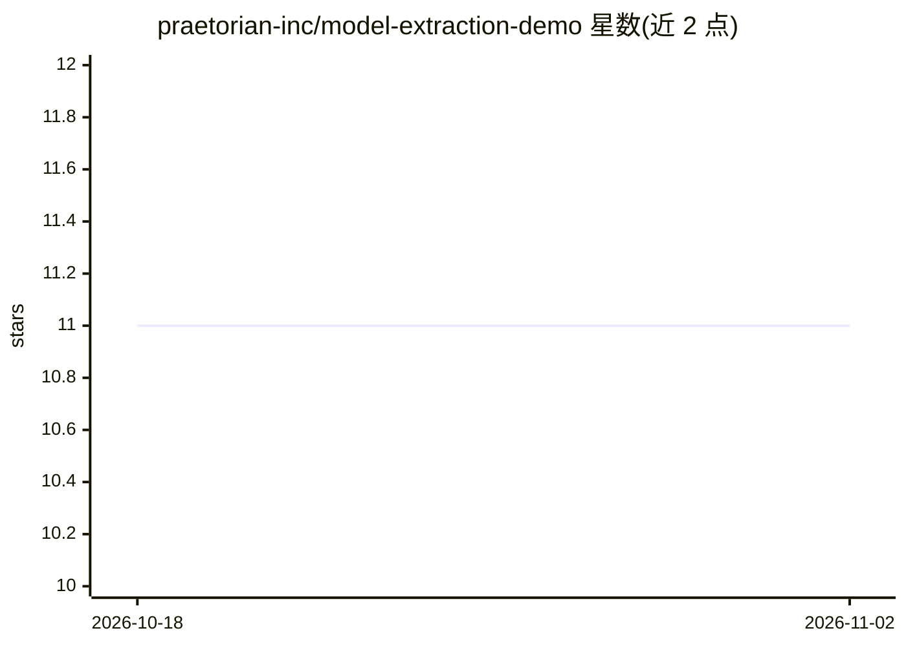

# praetorian-inc/model-extraction-demo

⭐ 11 · Python · Apache-2.0 · 推送 2025-12-01 · [GitHub](https://github.com/praetorian-inc/model-extraction-demo) · 组织维护

**模型提取攻击演示：用知识蒸馏窃取黑盒 ML 模型**

配合安全博客发布的教学演示：先在 Fashion-MNIST 上训练一个 CNN 作为模拟的受害模型，攻击者仅以 1,000 次 API 查询记录软标签，再用温度=3 的知识蒸馏损失训练一个结构不同的替身模型，最终整体预测一致率达 81.5%，且复现了受害模型的错误模式。附带预测对比可视化、逐类别一致率图表与 Gradio 交互演示（本地 7860 端口），并列出输出扰动、查询监控、水印等防御措施供模型服务方参考。面向安全研究者与 ML 从业者，CPU 即可运行。

## 筛选速览

| 维度 | 判定 | 备注 |
|---|---|---|
| AI 角色 | `ai-native` | 本体是模型或模型工具 |
| 许可风险 | `permissive` | Apache-2.0 |
| 部署形态 | `library` | 以包/库形式分发 |
| 模型依赖 | — | README 未给出锁定关系 |
| 硬件要求 | — | 无带数字的原话,不猜 |
| 安装摩擦 | `low` | 无编译、无系统依赖或容器化 |
| 成熟度 | — | 结构信号不足 |

## 能力要点

- 仅 1,000 次查询的黑盒模型提取攻击流程
- 软标签 + 温度 3.0 的知识蒸馏损失实现
- 预测对比网格、逐类别一致率与混淆矩阵可视化
- 包含输出扰动、查询监控、水印等 5 类防御建议

## 适用场景

- 我想直观了解模型提取攻击如何仅靠 API 查询复制模型
- 为 ML 安全培训或课程做可运行的攻防演示
- 评估自家模型 API 面临的窃取风险并对照防御措施

## 场景标签

`网络安全` `教程课程` · 领域:学习与行业

## 证据(README 行号)

> L3: A hands-on demonstration of how machine learning models can be "stolen" through knowledge distillation attacks. This
> L22: |**Method**|Knowledge distillation using soft labels|
> L128:     probs = victim_model.predict_proba(images)  # Soft labels!

## 星数曲线

2026-10-18 11 → 2026-11-02 11（+0）

---
*卡片 v1 · prompt 1.4 · 生成 2026-11-01 · 置信度 mid · 依据 README sha `b87b71857996` · [字段定义](../../DATASET.md)*
