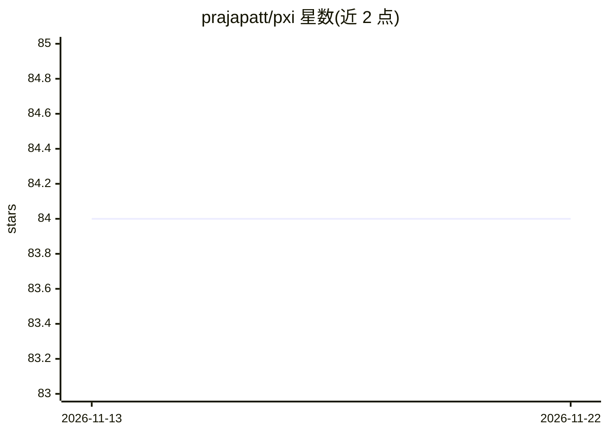

# prajapatt/pxi

⭐ 84 · Unlicense · 推送 2026-11-13 · [GitHub](https://github.com/prajapatt/pxi) · [官网](https://pxi.prajapatt.tech) · 个人维护

**信息不足：仅项目名与主题标签可确认**

README 仅含标题 'PXI - Prajapatt eXtreme Intelligence'。仓库主题标签标注 artificial-intelligence、artificial-intelligence-algorithms、artificial-neural-networks，据此可确认其定位与人工智能/神经网络相关，但具体功能、目标用户、安装方式与运行机制均无 README 文本可验证，无法进一步编目描述。

## 筛选速览

| 维度 | 判定 | 备注 |
|---|---|---|
| AI 角色 | `ai-ecosystem` | LLM/agent 周边工具 |
| 许可风险 | `permissive` | Unlicense |
| 部署形态 | `None` |  |
| 模型依赖 | — | README 未给出锁定关系 |
| 硬件要求 | — | 无带数字的原话,不猜 |
| 安装摩擦 | `low` | 无编译、无系统依赖或容器化 |
| 成熟度 | — | 结构信号不足 |

## 能力要点

- 仓库主题标签含 artificial-intelligence、artificial-neural-networks
- 项目全称可从标题确认为 Prajapatt eXtreme Intelligence

## 适用场景

- 无法从 README 确认适用场景

## 场景标签

 · 领域:人工智能（具体领域无法确认）

## 证据(README 行号)

> L1: # ☃️ PXI - Prajapatt eXtreme Intelligence

## 星数曲线

2026-11-13 84 → 2026-11-22 84（+0）

---
*卡片 v1 · prompt 1.4 · 生成 2026-11-18 · 置信度 low · 依据 README sha `31ec02c1ebbe` · [字段定义](../../DATASET.md)*
