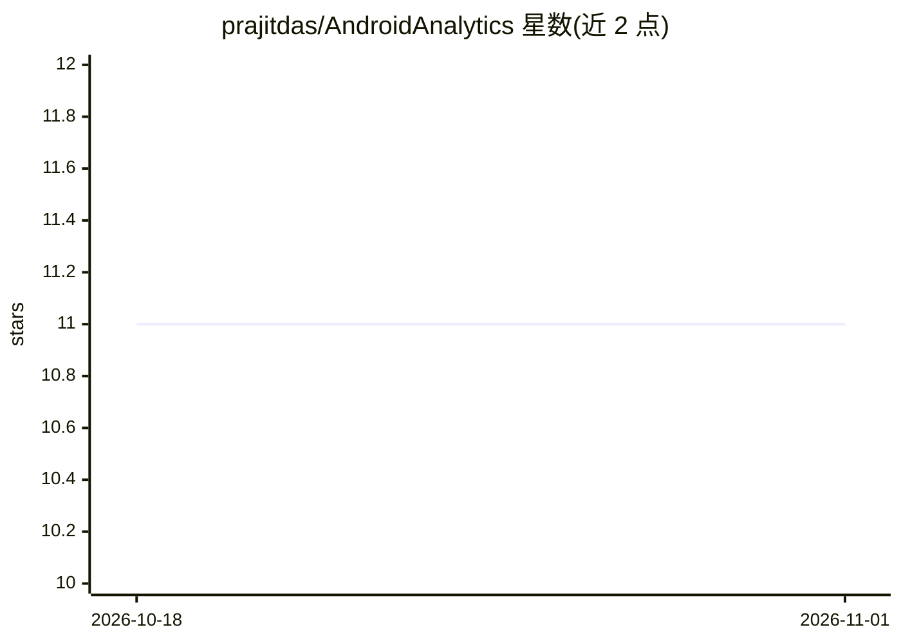

# prajitdas/AndroidAnalytics

⭐ 11 · Python · MIT · 推送 2026-01-23 · [GitHub](https://github.com/prajitdas/AndroidAnalytics) · [官网](https://mithril.online/) · 个人维护

**Google Play 应用数据与 APK 权限采集分析工具集**

一组 Python 脚本构成的 Google Play Store 数据采集流水线：爬取应用 URL 与元数据入库、下载 APK 或从连接的手机提取 APK，再通过 ApkTool 反编译提取 Manifest 中的权限（使用与提供）并存入数据库。面向需要构建 Play 应用与权限数据集的开发者/研究者。需要自行配置 MySQL 数据库连接，各模块按步骤顺序执行且相互依赖，尚无统一封装 API；部分模块（从手机提取 APK）需要 Android SDK 与 USB 调试模式。

## 筛选速览

| 维度 | 判定 | 备注 |
|---|---|---|
| AI 角色 | `ai-enhanced` | 去掉 AI 部分产品仍成立 |
| 许可风险 | `permissive` | MIT |
| 部署形态 | `library` | 以包/库形式分发 |
| 模型依赖 | — | README 未给出锁定关系 |
| 硬件要求 | — | 无带数字的原话,不猜 |
| 安装摩擦 | `low` | 无编译、无系统依赖或容器化 |
| 成熟度 | — | 结构信号不足 |

## 能力要点

- 爬取 Google Play 应用 URL 与应用数据并存入数据库
- 下载 APK 或经 USB 调试从手机提取 APK
- ApkTool 反编译 APK 并从 Manifest 提取使用/提供的权限入库
- 分步脚本设计，各步骤依赖前序步骤的产出

## 适用场景

- 我要批量采集 Google Play 应用元数据构建数据集
- 我需要分析 Android 应用申请和提供的权限
- 我想从已连接的手机中提取 APK 做权限研究

## 场景标签

`网页抓取` `网络安全` · 领域:效率与自动化

## 证据(README 行号)

> L48: * crawURLs.py: This is the main crawling script for crawling the Google Play Store. It obtains urls for apps and pa
> L66: * apkDecompile.py: This is the last step where we obtain the last piece of information for gathering information ab

## 星数曲线

2026-10-18 11 → 2026-11-01 11（+0）

---
*卡片 v1 · prompt 1.4 · 生成 2026-11-01 · 置信度 low · 依据 README sha `06916885edbb` · [字段定义](../../DATASET.md)*
