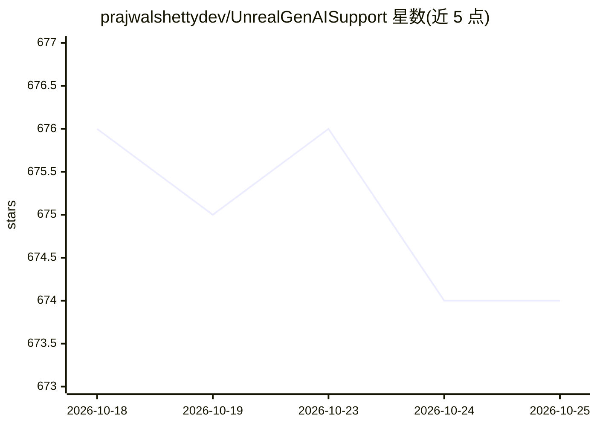

# prajwalshettydev/UnrealGenAISupport

⭐ 674 · C++ · MIT · 推送 2026-04-28 · [GitHub](https://github.com/prajwalshettydev/UnrealGenAISupport) · [官网](https://muddyterrain.com/docs/) · 个人维护

**Unreal Engine 的 LLM/GenAI 接入插件与 MCP 服务器**

C++ 编写的 Unreal Engine 免费插件，把 LLM/GenAI API 集成层封装为引擎内可用的 C++/Blueprint 接口：免费版支持 OpenAI Chat 与 Structured Outputs、Anthropic Claude Chat、XAI Grok Chat、DeepSeek Chat/Reasoning，并经 unreal-ollama 接入本地模型；另含面向 Claude Desktop/Claude Code/Cursor 的 Unreal MCP 服务器（README 注明 MCP 部分不再积极开发），支持生成蓝图、生成对象、运行 Python 脚本等。通过 git submodule 安装到 UE 项目，API key 经环境变量配置；同仓库推广 Fab.com 上的付费 Pro 插件（更多模型与功能）。

## 筛选速览

| 维度 | 判定 | 备注 |
|---|---|---|
| AI 角色 | `ai-ecosystem` | LLM/agent 周边工具 |
| 许可风险 | `permissive` | MIT |
| 部署形态 | `library` | 以包/库形式分发 |
| 模型依赖 | local-ok | 支持本地模型 |
| 硬件要求 | — | 无带数字的原话,不猜 |
| 安装摩擦 | `low` | 无编译、无系统依赖或容器化 |
| 成熟度 | — | 结构信号不足 |

## 能力要点

- C++/Blueprint 调用 OpenAI Chat 与 Structured Outputs
- 支持 Anthropic Claude、XAI Grok、DeepSeek 等 API，经 unreal-ollama 可用本地模型
- Unreal MCP 服务器：Claude Desktop/Claude Code/Cursor 控制蓝图生成、对象变换、Python 脚本执行
- 无外部依赖，可从构建中排除 MCP

## 适用场景

- 在 UE 游戏中为 NPC 接入 LLM 对话与 agentic 行为
- 让 Claude/Cursor 通过 MCP 直接操控 Unreal 编辑器生成蓝图与场景
- 打包构建中通过 GenSecureKey 设置运行时 API key

## 场景标签

`模型网关` · 领域:Agent 开发

## 证据(README 行号)

> L22: The "Unreal Engine Generative AI Support Plugin" allows you to focus on game development without worrying about the
> L62: - **OpenAI**: Chat (`gpt-4.1`, `gpt-4.1-mini`, `o4-mini`, `o3`, `o3-pro`), Structured Outputs
> L103: > **Other MCP options:** Epic Games is working on an official Unreal MCP integration for UE 5.8+. There's also Unr

## 星数曲线

2026-10-18 676 → 2026-10-25 674（-2）

---
*卡片 v1 · prompt 1.4 · 生成 2026-10-22 · 置信度 mid · 依据 README sha `927948435112` · [字段定义](../../DATASET.md)*
