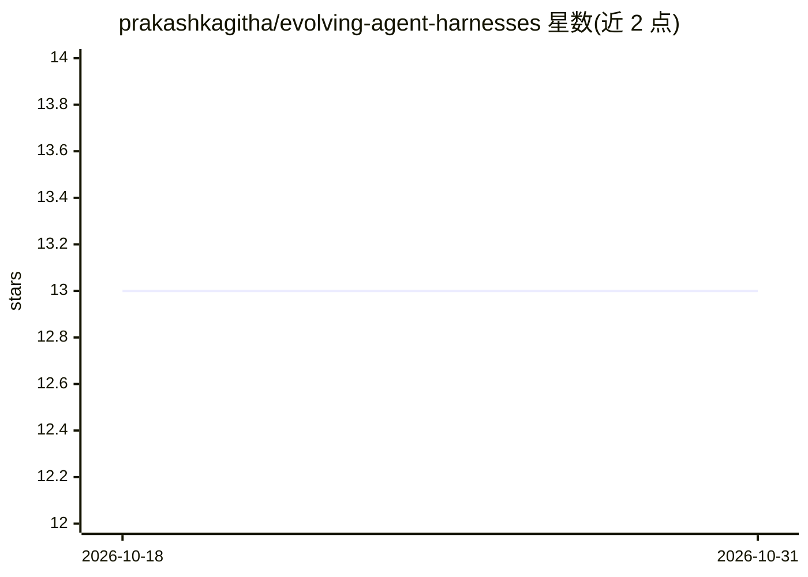

# prakashkagitha/evolving-agent-harnesses

⭐ 13 · Go · MIT · 推送 2026-07-01 · [GitHub](https://github.com/prakashkagitha/evolving-agent-harnesses) · 个人维护

**研究项目：让固定小模型自我改进 agent harness 结构**

关于 agent harness（结构+提示词包装层）演化的研究代码库，包含两项研究：Self-Harness 让固定不变的 Claude Haiku 读取自身执行失败、提出有界的 harness 编辑、经验证门筛选，在 SWE-bench Verified 28 题子集上从 64% 提升到 82%（held-out 集未复现该分离）；早期 BattleSnake 研究用 Sonnet 演化 Haiku harness。代码含控制器、工作流、基于 Apptainer 的 SWE-bench 评测后端与结果记录，运行于 Claude Dynamic Workflows。

## 筛选速览

| 维度 | 判定 | 备注 |
|---|---|---|
| AI 角色 | `ai-ecosystem` | LLM/agent 周边工具 |
| 许可风险 | `permissive` | MIT |
| 部署形态 | `library` | 以包/库形式分发 |
| 模型依赖 | locked-api |  |
| 硬件要求 | — | 无带数字的原话,不猜 |
| 安装摩擦 | `low` | 无编译、无系统依赖或容器化 |
| 成熟度 | — | 结构信号不足 |

## 能力要点

- 同一固定模型担任 miner/proposer/被改进对象，无需更强外部模型
- 验证接受门：仅当双 split 非回归且至少一 split 提升时采纳编辑
- SWE-bench Verified 用仓库自带隐藏测试在官方容器内评测
- 明确声明局限：held-out 集上未见与 1-shot 分离

## 适用场景

- 研究 agent harness 与提示词的自动优化方法
- 复现 SWE-bench Verified / BattleSnake 上的 harness 演化实验
- 了解推理时扩展与小模型多调用编排的实验证据

## 场景标签

`提示工程` `模型评测` `科研工具` · 领域:Agent 开发

## 证据(README 行号)

> L11: The model's weights are frozen — we can't change *what Haiku knows*. But we can change everything *around* it: how 
> L64: |**Self-Harness controller** — minimal-harness init, the two-split non-regression gate (`accept iff Δin ≥ 0 ∧ Δout 
> L69: Runs on **Claude Dynamic Workflows** — parallel agent orchestration with structured outputs.

## 星数曲线

2026-10-18 13 → 2026-10-31 13（+0）

---
*卡片 v1 · prompt 1.4 · 生成 2026-10-31 · 置信度 high · 依据 README sha `c2c2986ab742` · [字段定义](../../DATASET.md)*
