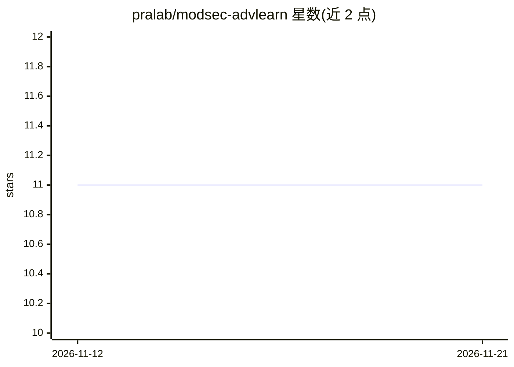

# pralab/modsec-advlearn

⭐ 11 · Python · MIT · 推送 2026-11-12 · [GitHub](https://github.com/pralab/modsec-advlearn) · 组织维护

**论文配套实验代码：用鲁棒 ML 对抗 SQL 注入攻击 WAF 场景**

IEEE TIFS 论文 ModSec-AdvLearn 的实验复现代码：围绕 ModSecurity v3.0.10 与 OWASP CoreRuleSet 搭建 WAF 检测环境，通过 pymodsecurity 绑定调用规则引擎检测传入载荷，再用 scripts 目录下的 Python 脚本运行实验。面向安全研究者复现论文结果；限制在于必须从源码编译指定版本的 ModSecurity（官方仓库开发停在 v3.0.3，需用 fork 构建），并自备规则集。

## 筛选速览

| 维度 | 判定 | 备注 |
|---|---|---|
| AI 角色 | `ai-native` | 本体是模型或模型工具 |
| 许可风险 | `permissive` | MIT |
| 部署形态 | `None` |  |
| 模型依赖 | — | README 未给出锁定关系 |
| 硬件要求 | — | 无带数字的原话,不猜 |
| 安装摩擦 | `low` | 无编译、无系统依赖或容器化 |
| 成熟度 | — | 结构信号不足 |

## 能力要点

- 复现论文对抗性 SQL 注入与鲁棒机器学习实验
- 基于 ModSecurity v3.0.10 + pymodsecurity 绑定构建检测管线
- 支持选用或自定义规则集（默认推荐 OWASP CRS v4.0.0）
- 实验通过 scripts 目录的 Python 脚本从项目根目录执行

## 适用场景

- 复现论文中的 WAF 对抗性机器学习实验
- 搭建 ModSecurity + OWASP CRS 的 SQL 注入检测实验环境
- 研究 WAF 规则与机器学习检测的组合效果

## 场景标签

`网络安全` `模型评测` · 领域:评测与运维

## 证据(README 行号)

> L45: All experiments can be executed using the Python scripts within the `scripts` folder. The scripts must be executed 
> L30: In `modsec-learn` ModSecurity methods are implemented via pymodsecurity.

## 星数曲线

2026-11-12 11 → 2026-11-21 11（+0）

---
*卡片 v1 · prompt 1.4 · 生成 2026-11-18 · 置信度 mid · 依据 README sha `940695b96638` · [字段定义](../../DATASET.md)*
