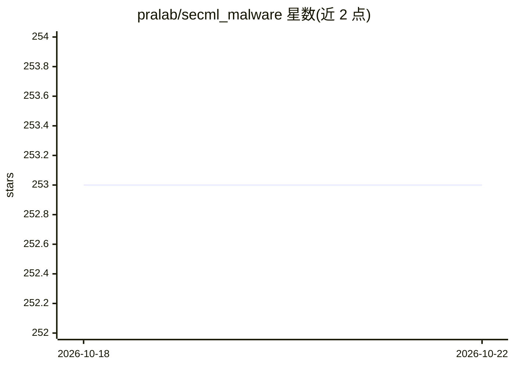

# pralab/secml_malware

⭐ 253 · Python · MIT · 推送 2025-11-27 · [GitHub](https://github.com/pralab/secml_malware) · [官网](https://secml-malware.readthedocs.io/) · 组织维护

**针对 Windows 恶意软件检测器的对抗攻击 Python 库**

基于 SecML 构建的 Python 库，用于对机器学习 Windows 恶意软件分类器创建对抗攻击，收录 Partial DOS Header 操纵、Padding、GAMMA、FGSM padding+slack、内容移位与 DOS 头扩展等多篇文献提出的攻击形式化。内置 EndGame 训练的 MalConv 预训练模型用于测试，可选安装 Nevergrad 加速黑盒攻击。通过 pip 安装（Python 3.9，Apple Silicon 需 conda 安装 lightgbm），提供 Dockerfile 与 Jupyter notebook 教程。由 PRA 实验室维护，获 EU SAFER 项目资助。

## 筛选速览

| 维度 | 判定 | 备注 |
|---|---|---|
| AI 角色 | `ai-native` | 本体是模型或模型工具 |
| 许可风险 | `permissive` | MIT |
| 部署形态 | `self-host` | docker 或自建部署 |
| 模型依赖 | — | README 未给出锁定关系 |
| 硬件要求 | — | 无带数字的原话,不猜 |
| 安装摩擦 | `low` | 无编译、无系统依赖或容器化 |
| 成熟度 | — | 结构信号不足 |

## 能力要点

- 实现多种文献提出的对抗攻击（GAMMA、Padding、DOS Header 操纵等）
- 内置 EndGame 预训练 MalConv 模型用于测试
- 可选 Nevergrad 加速黑盒攻击
- 提供 Dockerfile 与 Jupyter notebook 教程

## 适用场景

- 评估 Windows 恶意软件分类器的对抗鲁棒性
- 复现恶意软件对抗攻击研究的方法
- 在隔离容器中测试对抗样本生成流程

## 场景标签

`网络安全` `科研工具` · 领域:学习与行业

## 证据(README 行号)

> L10: Python library for creating adversarial attacks against Windows Malware detectors.
> L11: Built on top of SecML, SecML Malware includes most of the attack proposed in the state of the art.

## 星数曲线

2026-10-18 253 → 2026-10-22 253（+0）

---
*卡片 v1 · prompt 1.4 · 生成 2026-10-22 · 置信度 high · 依据 README sha `2a8d46fe6682` · [字段定义](../../DATASET.md)*
