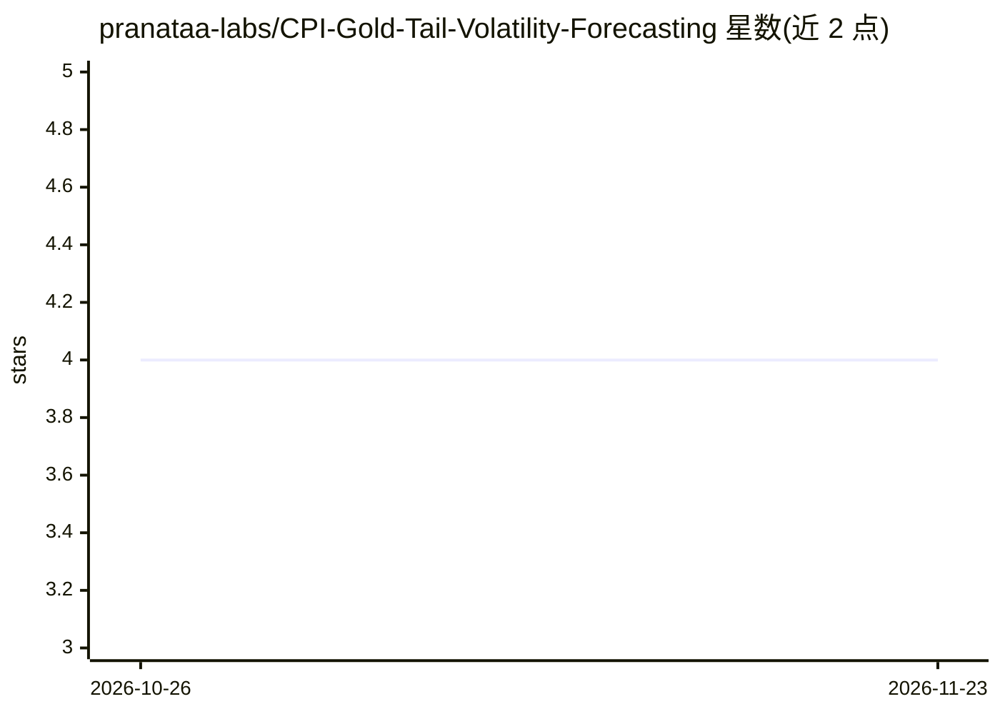

# pranataa-labs/CPI-Gold-Tail-Volatility-Forecasting

⭐ 4 · Jupyter Notebook · MIT · 推送 2026-10-23 · [GitHub](https://github.com/pranataa-labs/CPI-Gold-Tail-Volatility-Forecasting) · 组织维护

**基于美国 CPI 意外偏差预测黄金尾部波动风险的量化研究框架**

从美国 CPI 公布数据（实际值 vs 共识预期）构建意外偏差向量与分歧特征，经 Z-Score 标准化后用机器学习分类模型预测 XAU/USD 黄金出现 ≥350 pips 尾部波动事件的概率及方向偏斜。基于 2020–2024 共 60 次历史公布训练、20 次样本外评估，报告 Precision/Recall/F1/ROC-AUC/Brier Score。提供 Windows 批处理、CLI 与 Jupyter 三种运行方式，并附 MetaTrader 4/5 跨式策略执行手册；声明仅用于实证研究与风险建模。

## 筛选速览

| 维度 | 判定 | 备注 |
|---|---|---|
| AI 角色 | `ai-native` | 本体是模型或模型工具 |
| 许可风险 | `permissive` | MIT |
| 部署形态 | `None` |  |
| 模型依赖 | — | README 未给出锁定关系 |
| 硬件要求 | — | 无带数字的原话,不猜 |
| 安装摩擦 | `low` | 无编译、无系统依赖或容器化 |
| 成熟度 | — | 结构信号不足 |

## 能力要点

- 从 CPI 实际值与共识偏差构建意外向量并输出尾部波动概率预测
- 报告 Precision/Recall/F1/ROC-AUC/Brier 等样本外验证指标
- 内置 data/ 目录 80 次官方历史 CPI 公布记录（CSV）
- 提供 bat 启动器、CLI 与 Jupyter 三种运行方式及 MetaTrader 执行手册

## 适用场景

- 在 CPI 公布前评估黄金尾部波动概率
- 研究宏观数据意外偏差与价格波动的关系
- 按手册配置 MetaTrader 跨式挂单策略

## 场景标签

`金融量化` · 领域:学习与行业

## 证据(README 行号)

> L9: > **Institutional quantitative framework predicting tail volatility risk (≥ 350 pips / $35.00 USD) and asymmetric di
> L38:     A["CPI Release Data: Actual vs. Forecast"] --> B["Feature Engineering: Surprise Delta & Divergence Flag"]
> L49: |**Precision (Extreme Volatility Detection)**|**100.0%**|Zero false alarms: every triggered danger alert yielded mo

## 星数曲线

2026-10-26 4 → 2026-11-23 4（+0）

---
*卡片 v1 · prompt 1.4 · 生成 2026-11-21 · 置信度 high · 依据 README sha `467189d7d12f` · [字段定义](../../DATASET.md)*
