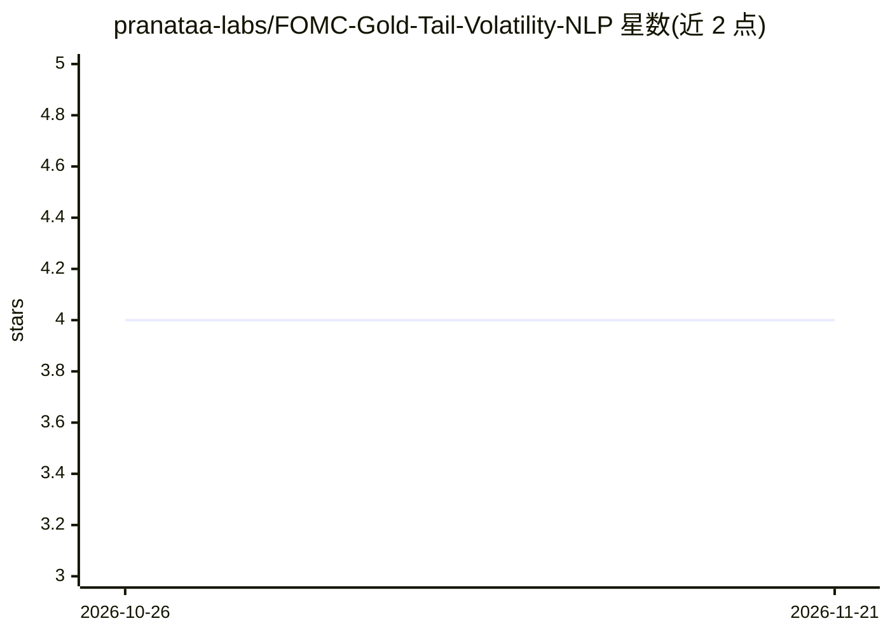

# pranataa-labs/FOMC-Gold-Tail-Volatility-NLP

⭐ 4 · Jupyter Notebook · MIT · 推送 2026-10-23 · [GitHub](https://github.com/pranataa-labs/FOMC-Gold-Tail-Volatility-NLP) · 个人维护

**量化研究者用 TF-IDF 从 FOMC 纪要预测黄金尾部波动**

基于 N-Gram TF-IDF 与余弦相似度的 Python 框架：读取 FOMC 新闻发布会 PDF 转录稿，提取美联储主席发言后与历史基准比对，输出盘中波动幅度超过 400 pips 的概率（阈值 53%），并给出 MetaTrader 4/5 的跨式挂单执行手册。含 45 份历史转录稿数据集、样本外评估指标（准确率 70.0%、ROC-AUC 0.571）。提供 Windows 批处理启动、终端脚本与 Jupyter notebook 三种运行方式，README 附带风险免责声明。

## 筛选速览

| 维度 | 判定 | 备注 |
|---|---|---|
| AI 角色 | `ai-native` | 本体是模型或模型工具 |
| 许可风险 | `permissive` | MIT |
| 部署形态 | `None` |  |
| 模型依赖 | — | README 未给出锁定关系 |
| 硬件要求 | — | 无带数字的原话,不猜 |
| 安装摩擦 | `low` | 无编译、无系统依赖或容器化 |
| 成熟度 | — | 结构信号不足 |

## 能力要点

- N-Gram TF-IDF + 余弦相似度将发布会文本映射为尾部波动概率
- 二分类目标：盘中波动 ≥400 pips 判为极端情形
- 附带 45 份 2020–2026 历史 FOMC 转录稿数据集
- bat 启动器 / python 脚本 / Jupyter notebook 三种运行入口

## 适用场景

- FOMC 发布会前评估黄金尾部波动风险概率
- 复现或研究文本特征与波动率的关系
- 按 README 的 SOP 生成跨式挂单参数

## 场景标签

`金融量化` · 领域:学习与行业

## 证据(README 行号)

> L9: > **Institutional quantitative NLP framework predicting tail volatility risk (≥ 400 pips / $40.00 USD) in Gold (XAU/
> L24: Volatility (Pips) = (High_FOMC - Low_FOMC) × 10
> L27: * **Binary Objective:** `Y = 1` if intraday range $\ge 400$ pips ($40.00 USD), and `Y = 0` if movement remains norm

## 星数曲线

2026-10-26 4 → 2026-11-21 4（+0）

---
*卡片 v1 · prompt 1.4 · 生成 2026-11-21 · 置信度 mid · 依据 README sha `067abf126579` · [字段定义](../../DATASET.md)*
