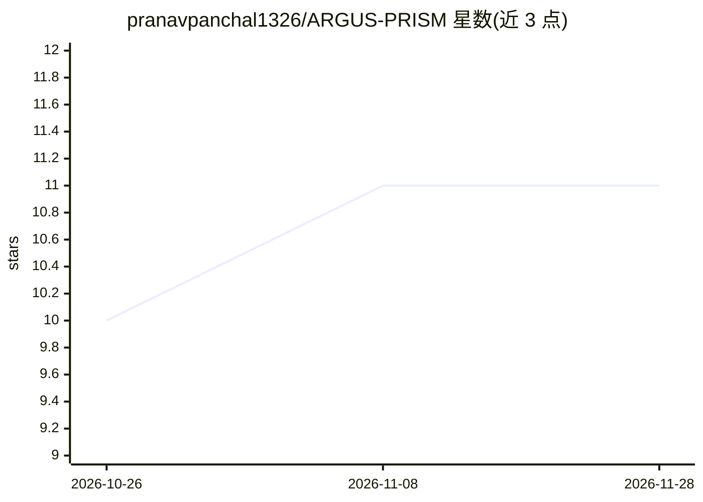

# pranavpanchal1326/ARGUS-PRISM

⭐ 11 · Python · 推送 2026-07-15 · [GitHub](https://github.com/pranavpanchal1326/ARGUS-PRISM) · 个人维护

**面向零售银行的账户洗钱（mule）检测与反洗钱调查平台**

摄入实时交易流，对每个账户输出 0–100 的 mule 风险评分（XGBoost + SHAP 归因，含规则回退路径），在 Neo4j 交易图上做环检测与污点传播，并覆盖案件管理、签名 STR 报告生成、HMAC 哈希链审计账本、RBAC 与 TOTP 多因素认证。后端 FastAPI、前端 React 19，通过 Docker Compose 在单机运行，数据存储不可用时降级为 SQLite 与内存事件总线。README 披露模型指标来自合成数据集。

## 筛选速览

| 维度 | 判定 | 备注 |
|---|---|---|
| AI 角色 | `ai-enhanced` | 去掉 AI 部分产品仍成立 |
| 许可风险 | `none` | — |
| 部署形态 | `self-host` | docker 或自建部署 |
| 模型依赖 | local-ok | 支持本地模型 |
| 硬件要求 | — | 无带数字的原话,不猜 |
| 安装摩擦 | `low` | 无编译、无系统依赖或容器化 |
| 成熟度 | — | 结构信号不足 |

## 能力要点

- WarmthScore：XGBoost 评分 + SHAP 归因，附带六信号加权规则回退
- Neo4j 图层：recruiter fan-out 环检测与 BFS 污点传播
- 一键生成签名 STR 包与 HMAC 哈希链审计账本
- 可选本地 Ollama 模型支撑的 AI examiner 助手

## 适用场景

- 对零售银行交易流做实时 mule 账户风险评分
- 沿交易图追踪并冻结 recruiter 团伙整个作案活动
- 将调查结果生成监管格式 STR 报告并留存审计链

## 场景标签

 · 领域:金融科技/反洗钱

## 证据(README 行号)

> L5: ARGUS-PRISM ingests a live transaction stream, scores every account for mule risk with an
> L67: |AI examiner|An optional grounded assistant backed by a local Ollama model, with a deterministic fallback that answ
> L97: |Assistant|Ollama (local LLM, optional)|

## 星数曲线

2026-10-26 10 → 2026-11-28 11（+1）

---
*卡片 v1 · prompt 1.4 · 生成 2026-11-18 · 置信度 mid · 依据 README sha `96bf3c5b171e` · [字段定义](../../DATASET.md)*
