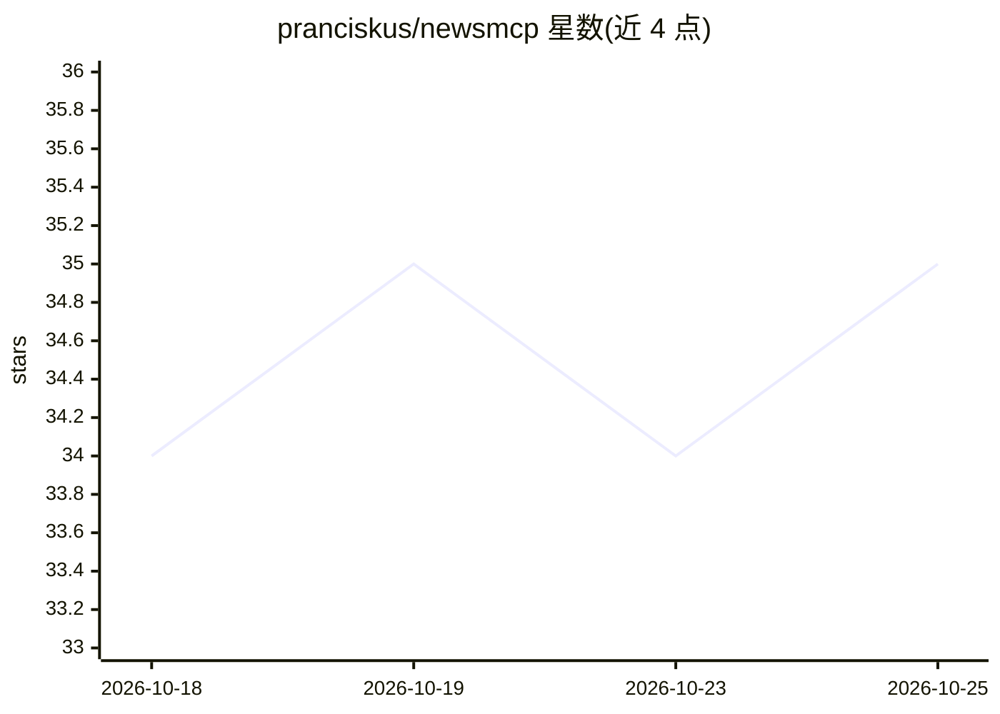

# pranciskus/newsmcp

⭐ 35 · TypeScript · MIT · 推送 2026-03-06 · [GitHub](https://github.com/pranciskus/newsmcp) · 个人维护

**为 AI agent 提供实时聚类世界新闻的 MCP 服务器**

MCP server 及配套 REST API：从数百个新闻源持续抓取文章，用向量嵌入将同一事件的报道聚类为事件，按 12 个主题与 30 个地区分类，按来源数、影响力与新鲜度排序。提供 4 个 MCP 工具（get_news / get_news_detail / get_topics / get_regions），可接入 Claude Desktop/Code、Cursor、Windsurf、Codex、Gemini CLI、OpenCode 等客户端，另有 OpenClaw 插件与 SKILL.md 技能形态。免费、无需 API key，npm 一条命令安装；新闻处理依赖远程后端 newsmcp.io。

## 筛选速览

| 维度 | 判定 | 备注 |
|---|---|---|
| AI 角色 | `ai-ecosystem` | LLM/agent 周边工具 |
| 许可风险 | `permissive` | MIT |
| 部署形态 | `library` | 以包/库形式分发 |
| 模型依赖 | — | README 未给出锁定关系 |
| 硬件要求 | — | 无带数字的原话,不猜 |
| 安装摩擦 | `low` | 无编译、无系统依赖或容器化 |
| 成熟度 | — | 结构信号不足 |

## 能力要点

- 数百源文章按向量嵌入聚类为事件，自动合并重复报道
- 12 主题 / 30 地区过滤，按来源数与影响力排序
- 4 个 MCP 工具 + 同数据 REST API（无需 MCP 直接调用）
- 免费、无需 API key，npm 一条命令安装

## 适用场景

- 让 Claude/Cursor 等 agent 客户端回答时事新闻问题
- 按主题与地区过滤获取当前重要事件
- 通过 REST API 直接获取聚类后的结构化新闻数据

## 场景标签

 · 领域:新闻资讯/Agent 工具

## 证据(README 行号)

> L9: Real-time news events, clustered by AI from hundreds of sources, classified by topic and geography, ranked by import
> L146: ## MCP Tools
> L193: ## REST API

## 星数曲线

2026-10-18 34 → 2026-10-25 35（+1）

---
*卡片 v1 · prompt 1.4 · 生成 2026-10-25 · 置信度 high · 依据 README sha `be5a20d28472` · [字段定义](../../DATASET.md)*
