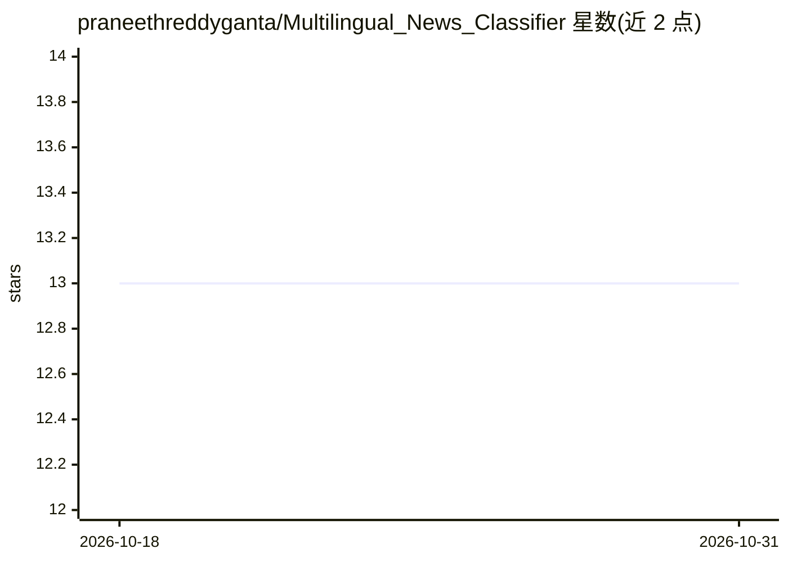

# praneethreddyganta/Multilingual_News_Classifier

⭐ 13 · Jupyter Notebook · MIT · 推送 2026-07-13 · [GitHub](https://github.com/praneethreddyganta/Multilingual_News_Classifier) · [官网](https://huggingface.co/spaces/Jaykumardas/Multilingual_News_Classifier) · 组织维护

**对印度语言新闻标题直接分类的 XLM-RoBERTa 系统（10 类）**

学术课程项目：在 IndicGLUE 的 iNLTK Headlines 数据集（Telugu/Malayalam/Marathi/Tamil/Gujarati，共 37,069 条）上，比较 TF-IDF+逻辑回归、双向 LSTM 与微调 XLM-RoBERTa 三种方案，把新闻标题直接分类为 10 个类别（测试准确率 86.12%），无需翻译预处理。采用部分层解冻的微调策略（仅训练第 10–11 层），模型权重托管在 HuggingFace Hub，Gradio 应用部署于 HuggingFace Spaces。README 记录了标签映射错误、类别不均衡、模型文件超 Git 限制等工程问题及修复。

## 筛选速览

| 维度 | 判定 | 备注 |
|---|---|---|
| AI 角色 | `ai-native` | 本体是模型或模型工具 |
| 许可风险 | `permissive` | MIT |
| 部署形态 | `None` |  |
| 模型依赖 | — | README 未给出锁定关系 |
| 硬件要求 | — | 无带数字的原话,不猜 |
| 安装摩擦 | `low` | 无编译、无系统依赖或容器化 |
| 成熟度 | — | 结构信号不足 |

## 能力要点

- 单一模型原生读取 5 种印度语言并分类为 10 类，无需翻译
- 三种模型（TF-IDF+LR / BiLSTM / XLM-RoBERTa）对比评测
- XLM-R 部分层解冻微调，训练时间减少约 60%
- Unicode 安全的文本预处理管线（保留 5 种文字的 Unicode 区段）

## 适用场景

- 我想直接对印度区域语言的新闻标题做主题分类，不做翻译
- 我想复用微调好的多语言分类模型或在线 Demo
- 我想参考多语言文本分类的三种建模方案对比

## 场景标签

`教程课程` `微调` · 领域:学习与行业

## 证据(README 行号)

> L9: **A production-ready multilingual NLP system that classifies Indian-language news headlines across 10 categories — n
> L27: This project solves that. We built a **single unified model** that reads Telugu, Malayalam, Marathi, Tamil, and Guj
> L130: ### 3️⃣ XLM-RoBERTa — Final Model 🚀

## 星数曲线

2026-10-18 13 → 2026-10-31 13（+0）

---
*卡片 v1 · prompt 1.4 · 生成 2026-10-31 · 置信度 high · 依据 README sha `e0ed027e22a2` · [字段定义](../../DATASET.md)*
