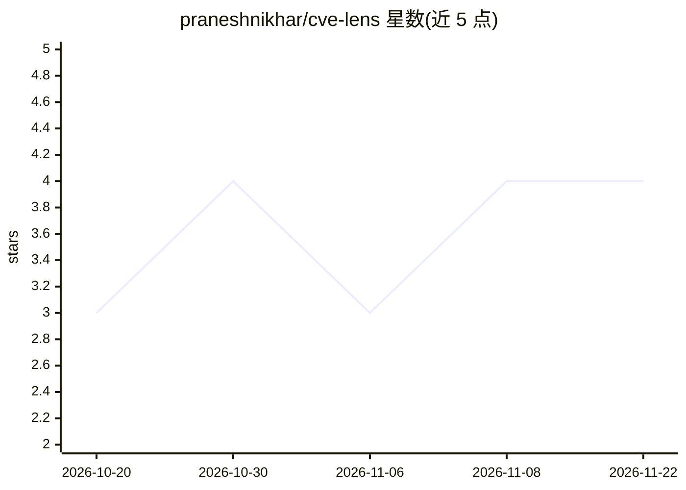

# praneshnikhar/cve-lens

⭐ — · [GitHub]() · 组织维护

**为 CVE Lite CLI 扫描器提供 Gemma 4 驱动的仪表盘**

OWASP CVE Lite CLI（本地 JS/TS 依赖漏洞扫描引擎）的配套仪表盘，以依赖方式消费引擎而非 fork。提供严重度卡片、漏洞分布图表、findings 浏览器与审计报告渲染；核心是 Gemma 4 模型层：逐条漏洞的通俗解释、按 fix-now/fix-soon/monitor/low 分诊，以及对扫描结果的引用式自然语言问答。模型输出经 schema 校验并缓存，超出扫描范围的问题拒绝回答；硬性规则是模型只解释与排序，不增删漏洞。默认本地 Ollama 运行 Gemma 4，Gemini API 模式可选开启。Hackathon 构建阶段，修复计划导出等仍在进行中。

## 筛选速览

| 维度 | 判定 | 备注 |
|---|---|---|
| AI 角色 | `ai-native` | 本体是模型或模型工具 |
| 许可风险 | `permissive` | — |
| 部署形态 | `library` | 以包/库形式分发 |
| 模型依赖 | local-ok | 支持本地模型 |
| 硬件要求 | — | 无带数字的原话,不猜 |
| 安装摩擦 | `low` | 无编译、无系统依赖或容器化 |
| 成熟度 | `idea` | |

## 能力要点

- 逐条漏洞的 Gemma 4 解释、分诊与引用式问答，输出经校验并缓存
- 硬性边界：模型只解释/排序/规划，不增删或升级 finding
- 默认本地 Ollama 运行 Gemma 4，数据不出机器；Gemini API 为可选模式
- 内置 173 条 finding 的样例数据，克隆后无需扫描即可运行

## 适用场景

- 扫描自己的 JS/TS 项目并在仪表盘中浏览依赖漏洞
- 让模型解释每条漏洞的影响并给出修复优先级
- 用自然语言向扫描结果提问并跳转到对应条目

## 场景标签

`网络安全` · 领域:学习与行业

## 证据(README 行号)

> L14: - **Gemma 4 explanations** — per-finding plain-English *summary*, *why it matters*, and *project impact*, built fro
> L16: - **Chat over findings** — natural-language Q&A over the loaded scan ("which criticals are transitive but fixable?"
> L17: - **Local-first AI** — the default mode runs Gemma 4 on your machine via Ollama; nothing leaves your machine. Gemin

## 星数曲线

2026-10-20 3 → 2026-11-22 4（+1）

---
*卡片 v1 · prompt 1.4 · 生成 2026-11-21 · 置信度 high · 依据 README sha `a351e59a85cc` · [字段定义](../../DATASET.md)*
