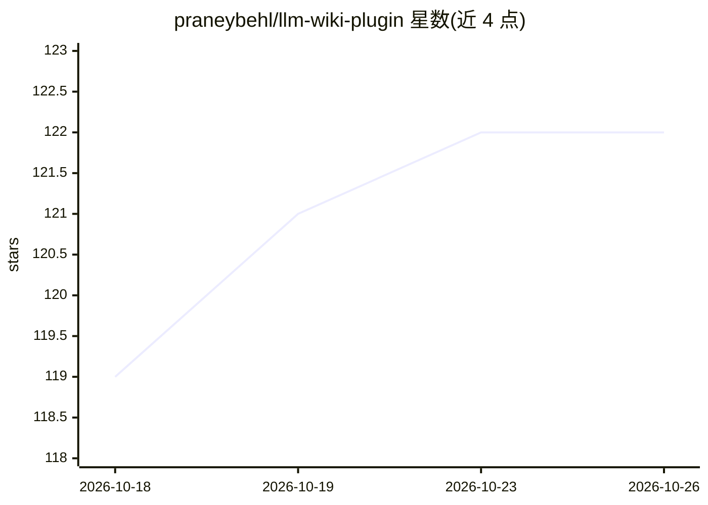

# praneybehl/llm-wiki-plugin

⭐ 122 · TypeScript · MIT · 推送 2026-09-13 · [GitHub](https://github.com/praneybehl/llm-wiki-plugin) · [官网](https://praneybehl.github.io/llm-wiki-plugin/) · 个人维护

**把 PDF/文章/笔记变成 AI 代理可共享检索的 Markdown 知识库插件**

面向 Claude Code、Codex、Cursor、Gemini CLI 等编码代理的技能/插件：将 PDF、文章、转录与笔记摄入为相互链接的 Markdown 维基页面，代理可检索、引用并回写答案，另有结构 lint、知识图谱层与经验学习（/wiki:learn、/wiki:evolve）工作流。默认语义搜索完全本地（FastEmbed + sqlite-vec + bge-small-en-v1.5），无需托管向量库。以 Claude Code 原生插件或 agentskills.io 技能格式分发，前置依赖仅为 uv；九个 /wiki:* 斜杠命令仅限 Claude Code，其他代理经自然语言调用。README 声明其演化实验未测得质量提升。

## 筛选速览

| 维度 | 判定 | 备注 |
|---|---|---|
| AI 角色 | `ai-ecosystem` | LLM/agent 周边工具 |
| 许可风险 | `permissive` | MIT |
| 部署形态 | `library` | 以包/库形式分发 |
| 模型依赖 | — | README 未给出锁定关系 |
| 硬件要求 | — | 无带数字的原话,不猜 |
| 安装摩擦 | `low` | 无编译、无系统依赖或容器化 |
| 成熟度 | — | 结构信号不足 |

## 能力要点

- 摄入源文档并生成带索引与日志的链接式 Markdown 维基，回答带 [[wikilink]] 引用
- 本地语义检索（FastEmbed/sqlite-vec/bge-small-en-v1.5），无需托管向量库或嵌入服务
- 兼容 9 种代理宿主（Claude Code/Codex/Cursor/Gemini CLI/OpenCode 等），维基本身代理无关
- 提供 /wiki:lint 健康检查、graph.sqlite 知识图谱层与 /wiki:learn、/wiki:evolve 经验固化命令

## 适用场景

- 把研究和论文积累成跨项目共享的个人知识库，供 AI 代理引用回答
- 团队项目内沉淀决策与会议记录，新会话直接读取既有知识
- 对已有维基做结构健康检查（孤儿页、断链、过期声明）

## 场景标签

`知识库管理` `文档解析` · 领域:知识与检索

## 证据(README 行号)

> L3: Turn PDFs, articles, transcripts, and notes into a shared wiki that your AI agents can search, cite, and keep up to 
> L5: Works with Claude Code, Codex, Cursor, Gemini CLI, OpenCode, OpenClaw, Pi, OMP, and Hermes. Read the documentation.
> L91: - **The wiki itself is agent-agnostic.** It's just a directory of markdown files. You can ingest with one agent and

## 星数曲线

2026-10-18 119 → 2026-10-26 122（+3）

---
*卡片 v1 · prompt 1.4 · 生成 2026-10-23 · 置信度 high · 依据 README sha `be09b92df72b` · [字段定义](../../DATASET.md)*
