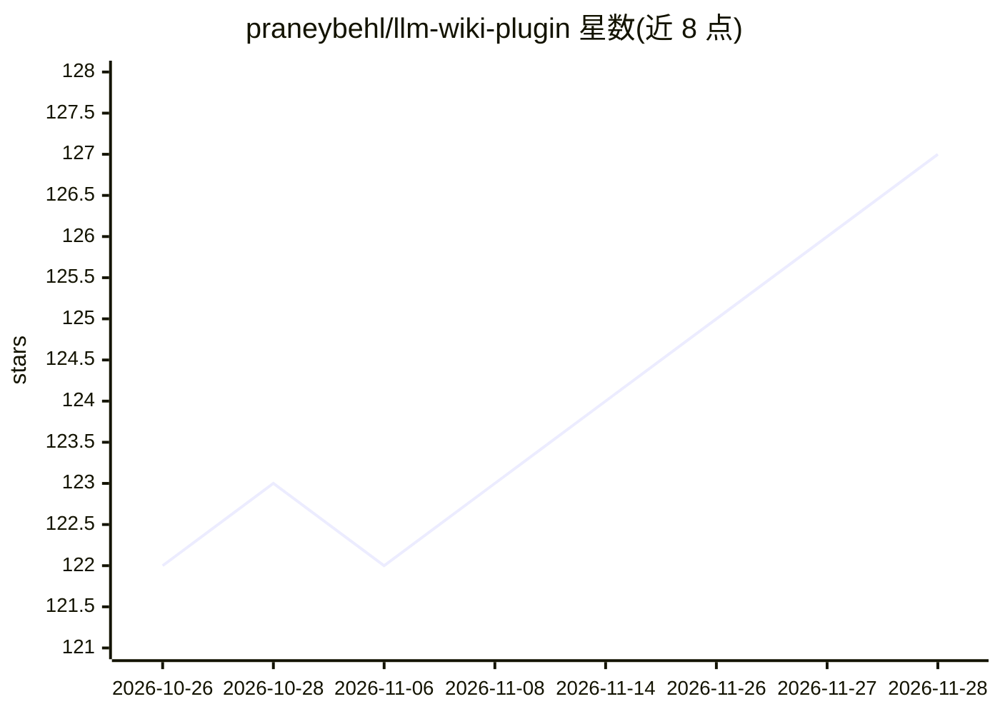

# praneybehl/llm-wiki-plugin

⭐ 127 · Python · MIT · 推送 2026-10-29 · [GitHub](https://github.com/praneybehl/llm-wiki-plugin) · [官网](https://praneybehl.github.io/llm-wiki-plugin/) · 个人维护

**给 AI Agent 搭建可搜索、可引用、自维护的 Markdown 知识库**

以 Claude Code 插件与 agentskills.io 标准技能形式提供：将 PDF、文章、转录、笔记等来源经 Agent 转化为带 wikilink 的 Markdown 页面，提供 /wiki:init、ingest、query、lint、stats、graph、learn、evolve、migrate、upgrade 十个命令，语义检索默认本地运行（FastEmbed + sqlite-vec + BAAI/bge-small-en-v1.5），全部内容保留为可读 Markdown。可选通过 Cloudflare Worker 部署托管 wiki，供多机 Agent 经 MCP/JSON API 共享读写。斜杠命令仅限 Claude Code，其他 Agent 通过自然语言调用技能。

## 筛选速览

| 维度 | 判定 | 备注 |
|---|---|---|
| AI 角色 | `ai-ecosystem` | LLM/agent 周边工具 |
| 许可风险 | `permissive` | MIT |
| 部署形态 | `library` | 以包/库形式分发 |
| 模型依赖 | — | README 未给出锁定关系 |
| 硬件要求 | — | 无带数字的原话,不猜 |
| 安装摩擦 | `low` | 无编译、无系统依赖或容器化 |
| 成熟度 | — | 结构信号不足 |

## 能力要点

- 来源一次性摄入为互链 Markdown 页面，查询答案带 [[wikilink]] 引用
- 本地语义检索：FastEmbed + sqlite-vec + BAAI/bge-small-en-v1.5，无托管向量库
- 十层图层与 /wiki:lint 健康检查（孤儿页、断链、过期声明）
- /wiki:learn 与 /wiki:evolve 从已完成任务沉淀经验并演化技能

## 适用场景

- 把论文、会议记录、客户访谈沉淀为跨项目共享的 Agent 记忆
- 让多个编码 Agent（Claude Code/Codex/Cursor 等）读写同一份 wiki
- 定期 lint 保持知识库链接与声明健康

## 场景标签

`知识库管理` `Agent 记忆` · 领域:Agent 开发

## 证据(README 行号)

> L5: Works with Claude Code, Codex, Cursor, Gemini CLI, OpenCode, OpenClaw, Pi, OMP, and Hermes. Read the documentation.
> L9: AI agents are good at the task in front of them, but a new session starts with limited context. LLM Wiki gives them 
> L38: Plugin/skill installation copies all agent-facing commands and bundled tools. Wiki initialization then performs man

## 星数曲线

2026-10-26 122 → 2026-11-28 127（+5）

---
*卡片 v1 · prompt 1.4 · 生成 2026-11-28 · 置信度 high · 依据 README sha `29ff3d3cf73a` · [字段定义](../../DATASET.md)*
