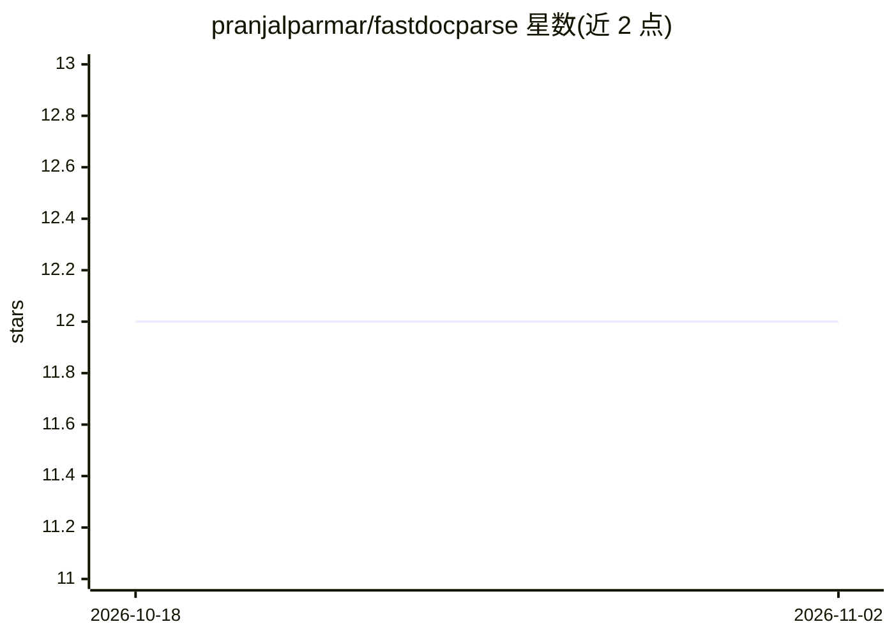

# pranjalparmar/fastdocparse

⭐ 12 · Python · MIT · 推送 2026-10-29 · [GitHub](https://github.com/pranjalparmar/fastdocparse) · 个人维护

**从半结构化文档提取结构化数据的 Python 库，逐字段溯源**

面向需要从发票、账单、税表、简历、银行对账单等半结构化文档中提取字段的开发者，以 Python 库 + CLI 双形式提供。调用任意 OpenAI 兼容 LLM（OpenAI、Ollama、vLLM、Groq 等）生成字段值，随后以确定性字符串/规则校验对已提取文本做逐字段判定：grounded（原文可见）、ungrounded（疑似幻觉）、missing_required、invalid_format、failed_check，无需额外 LLM 调用。基于文本层或本地 OCR 工作，非视觉 LLM 管线；手写表单与复杂多栏排版为其自述弱项，尚未做正式对比基准测试。

## 筛选速览

| 维度 | 判定 | 备注 |
|---|---|---|
| AI 角色 | `ai-native` | 本体是模型或模型工具 |
| 许可风险 | `permissive` | MIT |
| 部署形态 | `library` | 以包/库形式分发 |
| 模型依赖 | local-ok | 支持本地模型 |
| 硬件要求 | `cpu-ok` | |
| 安装摩擦 | `low` | 无编译、无系统依赖或容器化 |
| 成熟度 | — | 结构信号不足 |

## 能力要点

- 逐字段 grounding/confidence 标记，确定性规则校验、无额外 LLM 调用
- 支持任意 OpenAI 兼容端点，含 Ollama 本地模型（文档不离机）
- CLI 与 Python API 两种用法，可用自然语言描述生成 schema

## 适用场景

- 从发票、税表、简历等文档批量提取指定字段并标记可信度
- 对 LLM 提取结果做幻觉标记，供人工复核流程
- 本地小模型离线完成文档提取，不使用云端 API

## 场景标签

`文档解析` `OCR` · 领域:知识与检索

## 证据(README 行号)

> L7: Extract structured data from semi-structured documents (invoices, bills, tax forms, resumes, bank statements, shipme
> L16: - **`ungrounded`**: the value doesn't appear in the source, likely a hallucination. Flag for human review.
> L21: No extra LLM call for any of this: it's deterministic, string/rule-based validation against text you already extrac

## 星数曲线

2026-10-18 12 → 2026-11-02 12（+0）

---
*卡片 v1 · prompt 1.4 · 生成 2026-11-01 · 置信度 high · 依据 README sha `d89fdaabaa5a` · [字段定义](../../DATASET.md)*
