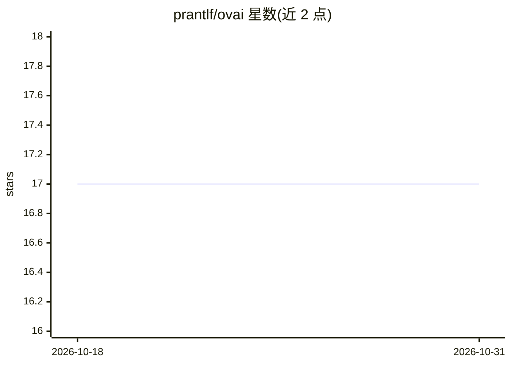

# prantlf/ovai

⭐ 17 · Go · MIT · 推送 2025-12-22 · [GitHub](https://github.com/prantlf/ovai) · 个人维护

**把 Vertex AI 包装成 ollama/OpenAI REST 接口的 HTTP 代理**

用 Go 编写的 HTTP 代理服务：将 Google Vertex AI 的 Gemini 嵌入、文本生成与对话能力通过 ollama REST API（/api/embed、/api/generate、/api/chat 等）及 OpenAI 兼容接口（/v1/chat/completions、/v1/models）对外暴露；支持流式 JSONL/SSE、工具调用、think 推理预算参数。设置 OLLAMA_ORIGIN 后，非 Gemini 类模型请求可转发给本地 ollama，从而以单一 ollama 接口同时使用云端与本地模型。使用需提供 Google 账号密钥文件；提供预编译二进制、Docker 镜像及源码构建三种方式。

## 筛选速览

| 维度 | 判定 | 备注 |
|---|---|---|
| AI 角色 | `ai-ecosystem` | LLM/agent 周边工具 |
| 许可风险 | `permissive` | MIT |
| 部署形态 | `self-host` | docker 或自建部署 |
| 模型依赖 | local-ok | 支持本地模型 |
| 硬件要求 | — | 无带数字的原话,不猜 |
| 安装摩擦 | `low` | 无编译、无系统依赖或容器化 |
| 成熟度 | — | 结构信号不足 |

## 能力要点

- 以 ollama REST 接口和 OpenAI 兼容接口访问 Vertex AI
- 可通过 OLLAMA_ORIGIN 将非 Vertex 模型请求转发给本地 ollama
- 支持流式 JSONL/SSE、工具调用与 Gemini thinking 预算控制
- 提供预编译二进制下载与 Docker/Docker Compose 运行方式

## 适用场景

- 让仅支持 ollama 接口的客户端直接调用 Gemini 云端模型
- 以单一 ollama 兼容端点混用 Vertex AI 与本地 ollama 模型
- 通过 OpenAI 兼容接口将现有应用接入 Vertex AI

## 场景标签

`模型网关` · 领域:Agent 开发

## 证据(README 行号)

> L3: HTTP proxy for accessing [Vertex AI] with the REST API interface of [ollama] or [OpenAI]. Optionally forwarding requ
> L64: Set the environment variable `OLLAMA_ORIGIN` to the origin of the `ollama` service to enable forwarding to `ollama`

## 星数曲线

2026-10-18 17 → 2026-10-31 17（+0）

---
*卡片 v1 · prompt 1.4 · 生成 2026-10-29 · 置信度 high · 依据 README sha `5e240cf240a4` · [字段定义](../../DATASET.md)*
