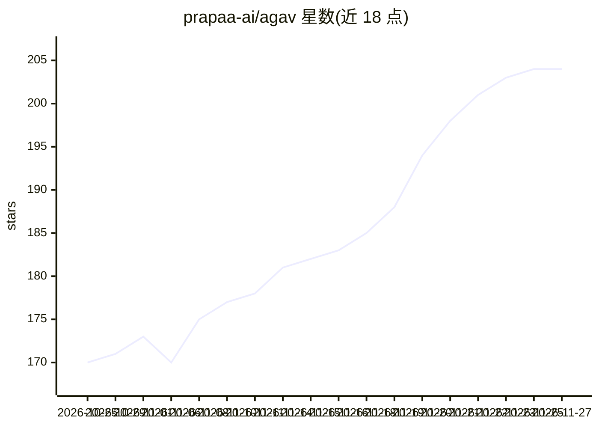

# prapaa-ai/agav

⭐ 204 · TypeScript · Apache-2.0 · 推送 2026-11-26 · [GitHub](https://github.com/prapaa-ai/agav) · [官网](https://agav.dev) · 组织维护

**给在真实代码仓库工作的开发者的终端原生 AI 编码代理**

一个自包含二进制分发的 CLI 编码代理：在终端中读取代码、编辑文件、运行测试并核验改动，支持交互与非交互（agav run）两种模式，后者可用于 CI 并输出 JSON Schema 结果。机制上强调 harness 效率：缓存上下文复用、中断无效修复循环、限制重试与预算、子代理隔离探索；提供会话恢复/分支、跨项目记忆、技能与子代理市场、后台任务、LSP 感知编辑与 /undo。模型可通过 provider 参数选择，本地模型经 OpenAI 兼容 API 接入；要求模型与聊天模板支持工具调用。Apache 2.0，支持 macOS/Linux 沙箱运行命令。

## 筛选速览

| 维度 | 判定 | 备注 |
|---|---|---|
| AI 角色 | `ai-native` | 本体是模型或模型工具 |
| 许可风险 | `permissive` | Apache-2.0 |
| 部署形态 | `None` |  |
| 模型依赖 | local-ok | 支持本地模型 |
| 硬件要求 | — | 无带数字的原话,不猜 |
| 安装摩擦 | `medium` | 含编译或系统依赖之一 |
| 成熟度 | `idea` | |

## 能力要点

- 一条命令安装的自包含二进制，无需 Node.js
- 多 provider 可选，会话内 /model 切换，本地模型经 OpenAI 兼容 API 接入
- 非交互模式 agav run 支持 CI 与可选 JSON Schema 输出
- 缓存复用、重试与预算控制等 harness 效率机制

## 适用场景

- 在终端里让 AI 代理检查代码库、改文件并跑测试验证
- 在 CI 流水线中以非交互方式运行编码代理任务
- 用本地推理服务器（llama.cpp/LM Studio）驱动编码代理
- 低成本批量运行 agent 基准任务并控制花费

## 场景标签

`编码 Agent` · 领域:编码与开发

## 证据(README 行号)

> L3: **Terminal-native autonomous agent for real repositories and projects**
> L41: agav

## 星数曲线

2026-10-25 170 → 2026-11-27 204（+34）

---
*卡片 v1 · prompt 1.4 · 生成 2026-11-26 · 置信度 high · 依据 README sha `3256981c3a11` · [字段定义](../../DATASET.md)*
