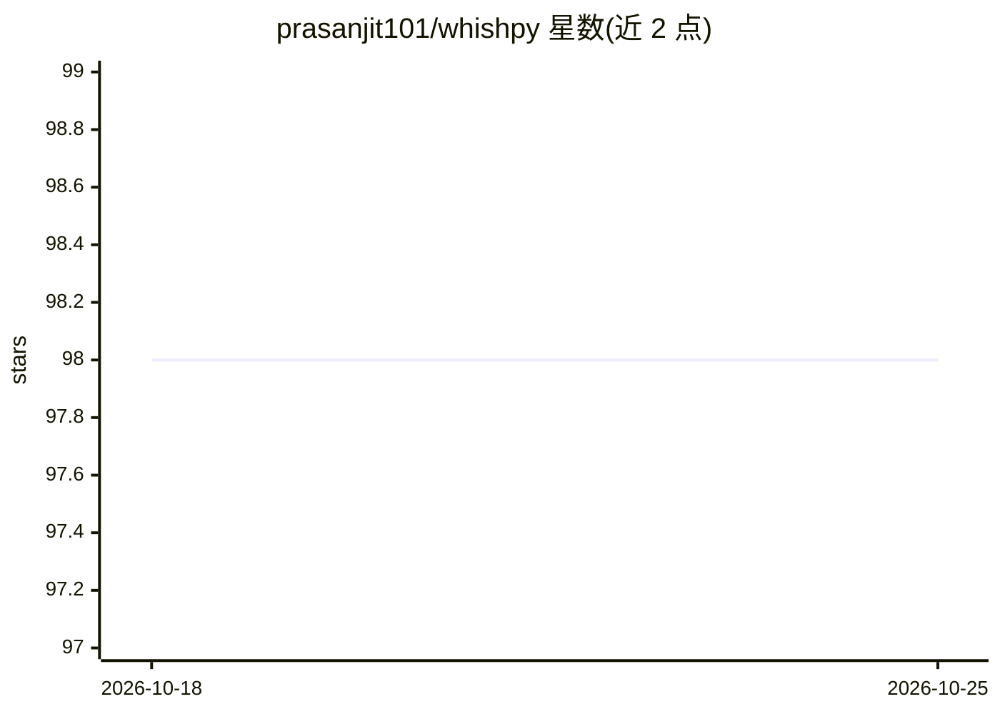

# prasanjit101/whishpy

⭐ 99 · Python · MIT · 推送 2025-11-19 · [GitHub](https://github.com/prasanjit101/whishpy) · 个人维护

**macOS 菜单栏语音转文字听写工具（Wispr Flow 替代）**

面向 Mac 用户的免费开源听写应用：在菜单栏点击麦克风图标或用快捷键触发录音（默认 5 秒或自定义时长），语音经处理后转录为文字并自动粘贴到光标处，依赖 Groq API key 做转录；另提供 'ask AI' 按钮对选中文本调用 AI 辅助。安装通过 setup.sh 脚本（含 PyAudio，需 Homebrew 的 portaudio），将 dist/Whishpy.app 移入 Applications 运行，需授予麦克风与辅助功能权限。README 声明已不再积极维护。

## 筛选速览

| 维度 | 判定 | 备注 |
|---|---|---|
| AI 角色 | `ai-native` | 本体是模型或模型工具 |
| 许可风险 | `permissive` | MIT |
| 部署形态 | `library` | 以包/库形式分发 |
| 模型依赖 | locked-api |  |
| 硬件要求 | — | 无带数字的原话,不猜 |
| 安装摩擦 | `low` | 无编译、无系统依赖或容器化 |
| 成熟度 | — | 结构信号不足 |

## 能力要点

- 菜单栏点击/快捷键录音，转录文字自动粘贴到光标位置
- 预设或自定义录音时长，图标显示就绪/录音/处理状态
- 'ask AI' 按钮对选中文本调用 AI 辅助
- setup.sh 一键安装，打包为 macOS .app

## 适用场景

- 在任意输入位置用语音快速输入文字
- 对选中文字用 AI 进行改写或辅助处理
- 替代付费听写工具做本地快捷听写

## 场景标签

`语音识别` `AI 助手` · 领域:对话与助手

## 证据(README 行号)

> L3: A free and open-source Wispr flow Alternative
> L21: 5. The transcribed text will be automatically pasted at your cursor position

## 星数曲线

2026-10-18 98 → 2026-10-25 98（+0）

---
*卡片 v1 · prompt 1.4 · 生成 2026-10-23 · 置信度 mid · 依据 README sha `274d67be0e64` · [字段定义](../../DATASET.md)*
