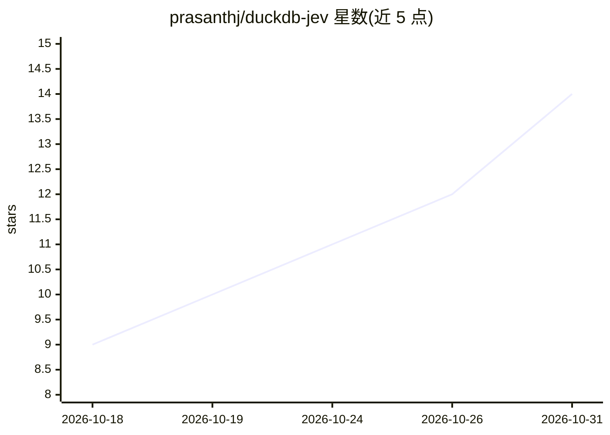

# prasanthj/duckdb-jev

⭐ 14 · C++ · Apache-2.0 · 推送 2026-10-21 · [GitHub](https://github.com/prasanthj/duckdb-jev) · [官网](https://docs.typesafe.ai/) · 个人维护

**DuckDB 原生扩展：从 SQL 调用 TypeSafe/Jev 做分类与语义判定**

C++ 编写的 DuckDB 扩展，通过 SQL 标量函数（jev/jev_choice/jev_score/jev_eval 等）将文本、JSON、STRUCT/LIST/ARRAY 证据发送到 TypeSafe/Jev HTTP API，返回布尔判定、Choice 分类、Score 评分与多问题评估。内部实现分块批处理（单请求最多 1,000 个判定）、10 并发连接池、查询内去重与缓存、严格响应校验与重试；凭据走 DuckDB secret 或 TYPESAFE_API_KEY 环境变量，不出现在查询结果中。面向希望在数据库内完成 LLM 分类/语义谓词计算、无需 Python UDF 或独立推理服务的开发者；需编译构建，推理依赖远程 API。

## 筛选速览

| 维度 | 判定 | 备注 |
|---|---|---|
| AI 角色 | `ai-native` | 本体是模型或模型工具 |
| 许可风险 | `permissive` | Apache-2.0 |
| 部署形态 | `None` |  |
| 模型依赖 | — | README 未给出锁定关系 |
| 硬件要求 | — | 无带数字的原话,不猜 |
| 安装摩擦 | `medium` | 含编译或系统依赖之一 |
| 成熟度 | — | 结构信号不足 |

## 能力要点

- 提供 jev/jev_noul/jev_choice/jev_score/jev_eval 等 SQL 函数与 jev_stats() 统计
- 批处理与流式执行：单请求最多打包 1,000 个判定，10 worker CURL 连接池
- 查询内证据去重、并发 miss 合并与带 TTL 的 LRU 缓存
- 支持 macOS/Linux x86-64 与 ARM64 原生构建，发布包含 SHA-256 与 SBOM

## 适用场景

- 在 SQL 中对表列数据做 LLM 分类、评分与语义过滤
- 批量处理工单/账户数据的多问题评估工作流
- 用 DuckDB 凭据 secret 管理 API key 并观测请求与缓存指标

## 场景标签

 · 领域:数据工程/LLM 推理接入

## 证据(README 行号)

> L10: High-throughput, robust native C++ DuckDB extension for semantic predicates, classification and rubric scoring thro
> L109: |`jev_choice(evidence, instructions, criteria)`|STRUCT with `choice`, `confidence`, `probabilities`, `model`, `cac

## 星数曲线

2026-10-18 9 → 2026-10-31 14（+5）

---
*卡片 v1 · prompt 1.4 · 生成 2026-10-31 · 置信度 high · 依据 README sha `068c44fb5bf8` · [字段定义](../../DATASET.md)*
