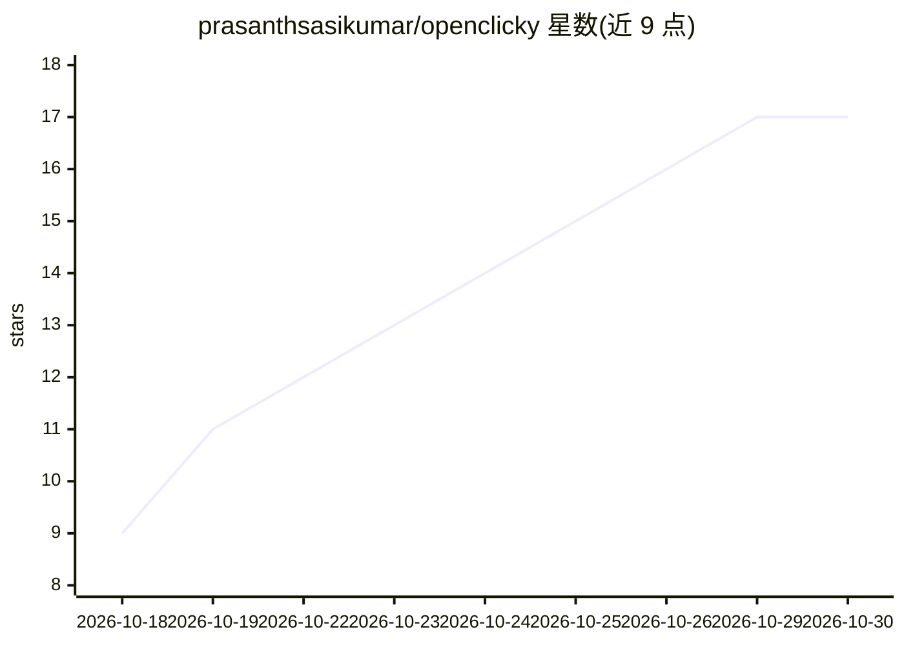

# prasanthsasikumar/openclicky

⭐ 17 · C# · NOASSERTION · 推送 2026-10-29 · [GitHub](https://github.com/prasanthsasikumar/openclicky) · [官网](https://openclicky.flowsxr.com) · 个人维护

**macOS 语音助手：语音问屏定位答案、离线听写、交接任务给 Codex**

菜单栏语音助手应用，支持 macOS（原生）、Windows（C#/WPF，新）与 Linux（Python/GTK，早期）。三个通道：按住快捷键口头发问，指针飞至屏幕上的答案处；按 fn 听写，默认用 Apple 端上识别器离线运行，可选 Sarvam（11 种印度语言）或 OpenClicky 后端/OpenAI key；"做工作"通道经 TypeScript CLI 通过 JSON-RPC 驱动 OpenAI Codex CLI。技能分三层（15 内置 agent 技能、17 应用教学技能、用户库）。可用自己的 OpenAI/Anthropic key 免账号直连，或用研究资助支撑的免费账号（限量 100 名）。MIT 许可。

## 筛选速览

| 维度 | 判定 | 备注 |
|---|---|---|
| AI 角色 | `ai-native` | 本体是模型或模型工具 |
| 许可风险 | `none` | NOASSERTION |
| 部署形态 | `desktop` | 安装包/桌面程序 |
| 模型依赖 | locked-api |  |
| 硬件要求 | — | 无带数字的原话,不猜 |
| 安装摩擦 | `low` | 无编译、无系统依赖或容器化 |
| 成熟度 | `idea` | |

## 能力要点

- 指针定位：语音提问后指针飞至屏幕答案处（Realtime 语音模型带 point_at 工具）
- 默认离线听写（Apple 端上识别器），可选 Sarvam 支持十一种印度语言
- 经 agent CLI 驱动 OpenAI Codex 的"做工作"通道
- 自己的 OpenAI/Anthropic key 免账号直连，不经官方服务器

## 适用场景

- 口头发问让指针指出屏幕上某功能的位置并获得语音步骤指引
- 在任何文本框用快捷键离线听写，按应用风格自动整理文本
- 把"make/fix/run"类任务口头交接给 Codex agent 执行

## 场景标签

`AI 助手` `语音 Agent` · 领域:对话与助手

## 证据(README 行号)

> L3: **Ask your Mac. It shows you where.** Hold ⌃ control + ⌥ option anywhere and ask out loud ("where do I
> L51: Nothing leaves your Mac until you choose an engine that needs the network (Settings → engine):
> L124:  fix / run…" requests to a Codex thread.

## 星数曲线

2026-10-18 9 → 2026-10-30 17（+8）

---
*卡片 v1 · prompt 1.4 · 生成 2026-10-29 · 置信度 high · 依据 README sha `e71667e78bfa` · [字段定义](../../DATASET.md)*
