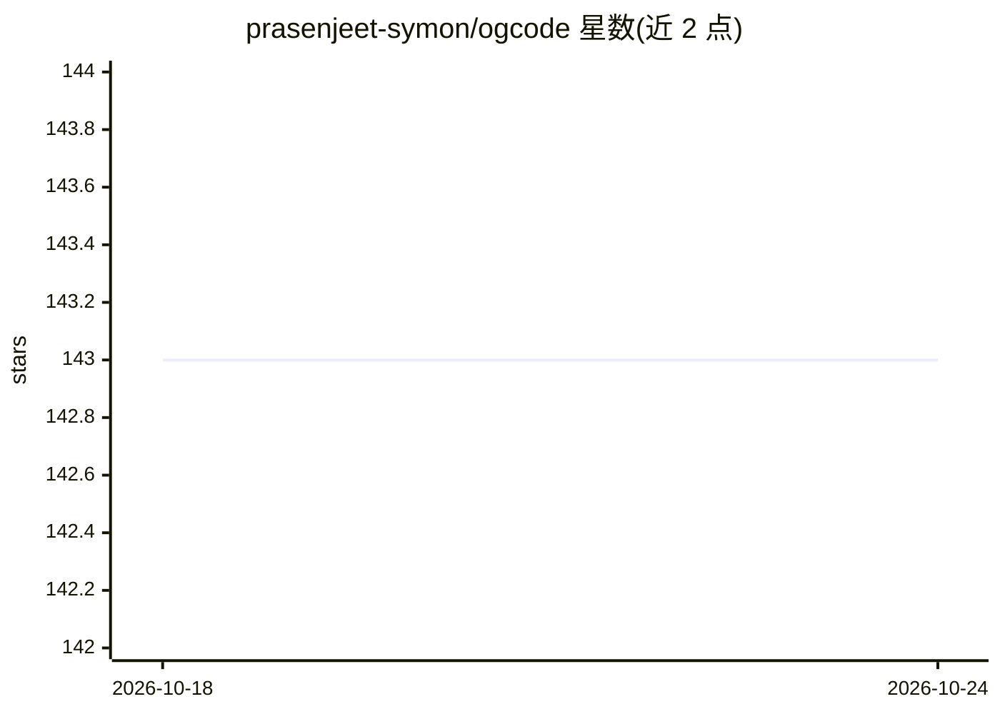

# prasenjeet-symon/ogcode

⭐ 143 · Go · AGPL-3.0 · 推送 2026-10-22 · [GitHub](https://github.com/prasenjeet-symon/ogcode) · [官网](https://ogcode.in) · 组织维护

**自托管的 AI 编程 Agent：理解代码库并完成开发工作**

用 Go 实现的可自托管 AI coding agent，通过浏览器访问本地 UI（默认 9595 端口）：在读写代码前先映射项目结构、跨文件实现功能与修复、运行构建测试、将目标拆解为任务并行执行并开 PR。内置 web 搜索、SKILL.md 工作流、MCP 服务器接入与决策记忆；会话级权限分 Ask/Auto/Yolo 三档。支持 Anthropic、OpenAI、OpenRouter 及 Ollama 本地模型，代码与会话数据留在本地。通过安装脚本、winget/PowerShell、Docker 或源码（需 CGO）安装。

## 筛选速览

| 维度 | 判定 | 备注 |
|---|---|---|
| AI 角色 | `ai-native` | 本体是模型或模型工具 |
| 许可风险 | `dual` | AGPL-3.0 |
| 部署形态 | `self-host` | docker 或自建部署 |
| 模型依赖 | local-ok | 支持本地模型 |
| 硬件要求 | — | 无带数字的原话,不猜 |
| 安装摩擦 | `low` | 无编译、无系统依赖或容器化 |
| 成熟度 | — | 结构信号不足 |

## 能力要点

- 读写前先映射项目结构，按精确行范围只读相关文件
- 目标拆解为任务并行执行，自动开 PR 供审查
- 会话级权限 Ask/Auto/Yolo 与决策记忆（不回放完整对话）
- 内置 web 搜索、SKILL.md 工作流与外部 MCP 服务器接入

## 适用场景

- 让 AI Agent 在本地代码库中实现功能或修复缺陷
- 在不联网用 API key 的情况下用 Ollama 本地模型跑编程 agent
- 把目标拆成任务并自动开 PR，人工审查后合并
- 在远程服务器部署并通过 SSH 隧道安全访问

## 场景标签

`编码 Agent` · 领域:编码与开发

## 证据(README 行号)

> L5:  The open-source, self-hostable AI coding agent.
> L7: Ogcode is an AI agent that understands your codebase, uses real tools, researches the web, remembers decisions, plan
> L52: Use a local model with Ollama — no API key needed:

## 星数曲线

2026-10-18 143 → 2026-10-24 143（+0）

---
*卡片 v1 · prompt 1.4 · 生成 2026-10-22 · 置信度 high · 依据 README sha `d662507ddb9c` · [字段定义](../../DATASET.md)*
