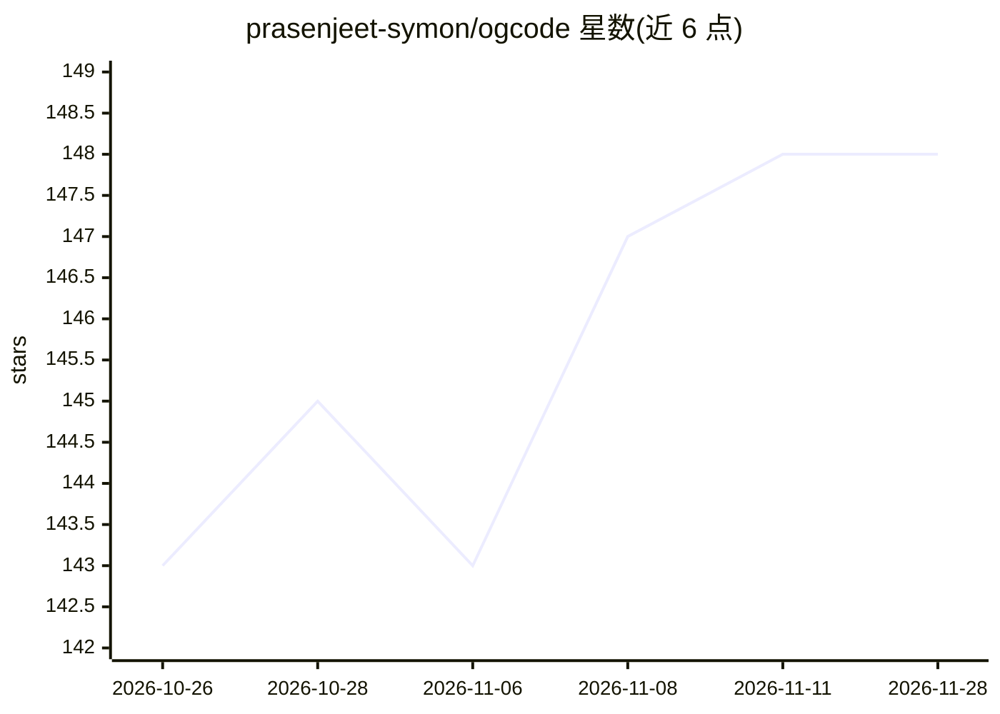

# prasenjeet-symon/ogcode

⭐ 148 · Go · AGPL-3.0 · 推送 2026-11-24 · [GitHub](https://github.com/prasenjeet-symon/ogcode) · [官网](https://ogcode.in) · 个人维护

**本地优先、自托管的编码 agent：浏览器中完成编码任务**

以 Go 编写的 AI 编码 agent，通过浏览器或终端运行：理解代码库（语义索引、按行号范围读取文件）、执行多文件修改、运行构建与测试、调用网页搜索与 MCP 服务器、跨会话记忆决策。权限分 Ask/Auto/Yolo 三档按会话控制写与 shell 访问。支持本地模型（Ollama）或配置 API key 使用云端模型；可远程部署，文档给出 SSH 隧道、反向代理、Docker 等安全边界建议。源码构建需 CGO_ENABLED=1。

## 筛选速览

| 维度 | 判定 | 备注 |
|---|---|---|
| AI 角色 | `ai-native` | 本体是模型或模型工具 |
| 许可风险 | `dual` | AGPL-3.0 |
| 部署形态 | `self-host` | docker 或自建部署 |
| 模型依赖 | local-ok | 支持本地模型 |
| 硬件要求 | — | 无带数字的原话,不猜 |
| 安装摩擦 | `low` | 无编译、无系统依赖或容器化 |
| 成熟度 | — | 结构信号不足 |

## 能力要点

- `ogcode index` 构建语义项目索引，按行号范围选择性读文件
- 三档会话权限（Ask/Auto/Yolo）控制每步审批与风险门控
- Ollama 本地模型无需 API key；兼容 OpenAI 格式本地端点
- 支持 SKILL.md 工作流、MCP 服务器、Mermaid/LaTeX/Plotly 富预览

## 适用场景

- 让 agent 在本地代码库中实现功能、修复失败测试
- 用 Ollama 本地模型处理代码，无需云端 API key
- 远程机器上部署 agent 并通过浏览器安全访问
- 跨会话记录决策，长任务保持上下文聚焦

## 场景标签

`编码 Agent` · 领域:编码与开发

## 证据(README 行号)

> L5:  The open-source, self-hostable AI coding agent.
> L7: Ogcode is an AI agent that understands your codebase, uses real tools, researches the web, remembers decisions, plan
> L59: Permissions are per session: **Ask** (approve each step), **Auto** (risk-gated), or **Yolo** (no prompts). Learn mo

## 星数曲线

2026-10-26 143 → 2026-11-28 148（+5）

---
*卡片 v1 · prompt 1.4 · 生成 2026-11-27 · 置信度 high · 依据 README sha `5d180662e215` · [字段定义](../../DATASET.md)*
