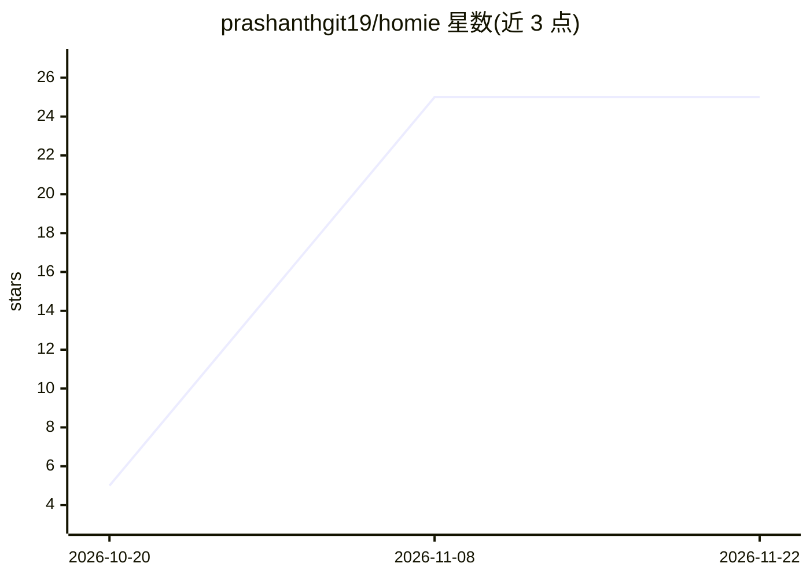

# prashanthgit19/homie

⭐ 25 · JavaScript · MIT · 推送 2026-11-20 · [GitHub](https://github.com/prashanthgit19/homie) · 个人维护

**给编码 agent 换聊天语气的插件：yo/dawg/mafa/off 四级**

面向 Claude Code、OpenCode、Codex、Pi 等编码 agent 的语气层插件：通过单个 SKILL.md 提示词与生命周期钩子，把 agent 的对话风格切换为 yo/dawg/mafa 三档朋友式语气（默认 dawg），技术回答、代码、命令与权限判断不变。遇生产故障、破坏性操作等场景自动切回平静语气。以插件、npx skills 或复制 AGENTS.md 方式安装，级别经 /homie 命令或环境变量配置并跨会话持久。

## 筛选速览

| 维度 | 判定 | 备注 |
|---|---|---|
| AI 角色 | `ai-ecosystem` | LLM/agent 周边工具 |
| 许可风险 | `permissive` | MIT |
| 部署形态 | `library` | 以包/库形式分发 |
| 模型依赖 | — | README 未给出锁定关系 |
| 硬件要求 | — | 无带数字的原话,不猜 |
| 安装摩擦 | `low` | 无编译、无系统依赖或容器化 |
| 成熟度 | — | 结构信号不足 |

## 能力要点

- 三档语气（yo/dawg/mafa），代码/提交信息/文档字符串保持原样
- 整个产品为单个提示词文件，经生命周期钩子每轮注入
- 生产故障、破坏性操作等场景自动切回平静语气
- 支持 Claude Code / OpenCode / Codex / Pi 及通用 skills 目录

## 适用场景

- 把编码 agent 的客服式口吻换成朋友式直说
- 按心情在多档语气间切换且不影响技术判断
- 让 agent 的坦率程度可配置并跨会话保持

## 场景标签

`提示工程` · 领域:Agent 开发

## 证据(README 行号)

> L9: Your coding agent didn't need another corporate assistant. **homie** switches
> L170: One prompt — `skills/homie/SKILL.md` — is the whole

## 星数曲线

2026-10-20 5 → 2026-11-22 25（+20）

---
*卡片 v1 · prompt 1.4 · 生成 2026-11-18 · 置信度 high · 依据 README sha `5730cc9f73f8` · [字段定义](../../DATASET.md)*
