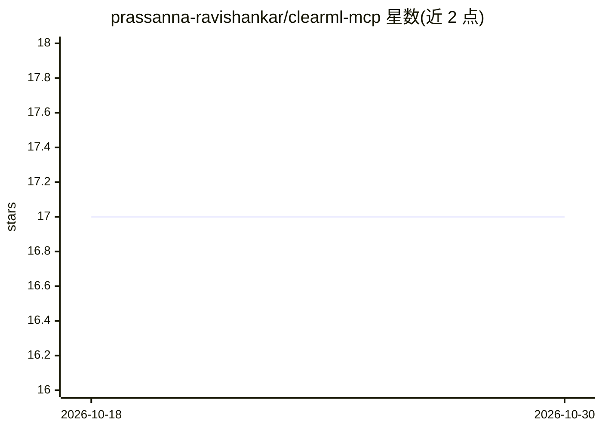

# prassanna-ravishankar/clearml-mcp

⭐ 17 · Python · MIT · 推送 2026-06-16 · [GitHub](https://github.com/prassanna-ravishankar/clearml-mcp) · 个人维护

**让 AI 助手查询分析 ClearML 实验的 MCP 服务器**

基于 Model Context Protocol 的服务器，向 Claude Desktop、Cursor、Continue、Cody 等 MCP 兼容的 AI 助手和编辑器暴露 14 个工具，用于读取 ClearML 平台的实验、模型与项目数据：任务信息/参数/指标/产物查询、模型浏览、项目统计与搜索、多任务指标对比。需预配置 ClearML 凭据（~/.clearml/clearml.conf）。以 PyPI 包提供，可 pip 安装或 uvx 免安装直接运行；开发使用 UV 管理依赖，测试覆盖率 69%。

## 筛选速览

| 维度 | 判定 | 备注 |
|---|---|---|
| AI 角色 | `ai-ecosystem` | LLM/agent 周边工具 |
| 许可风险 | `permissive` | MIT |
| 部署形态 | `library` | 以包/库形式分发 |
| 模型依赖 | — | README 未给出锁定关系 |
| 硬件要求 | — | 无带数字的原话,不猜 |
| 安装摩擦 | `low` | 无编译、无系统依赖或容器化 |
| 成熟度 | — | 结构信号不足 |

## 能力要点

- 14 个工具覆盖任务/模型/项目操作与多任务指标对比
- 兼容 Claude Desktop、Cursor、Continue、Cody 及任意 MCP 客户端
- 支持 pip 安装或 uvx 免安装直接运行

## 适用场景

- 在 AI 对话中直接查询 ClearML 项目的实验与训练曲线
- 让 AI 助手对比多个任务的指标表现
- 检索失败实验、超参数与模型产物

## 场景标签

`MLOps` · 领域:训练与推理

## 证据(README 行号)

> L9: A lightweight **Model Context Protocol (MCP) server** that enables AI assistants to interact with ClearML experiment
> L131: The ClearML MCP server provides **14 comprehensive tools** for ML experiment analysis:

## 星数曲线

2026-10-18 17 → 2026-10-30 17（+0）

---
*卡片 v1 · prompt 1.4 · 生成 2026-10-29 · 置信度 mid · 依据 README sha `8e1616a1b3ec` · [字段定义](../../DATASET.md)*
